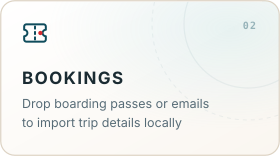
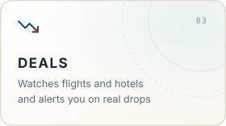
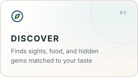
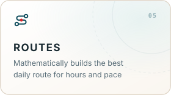
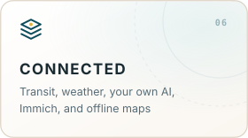

<div align="center">

<picture>
  <source media="(prefers-color-scheme: dark)" srcset="docs/assets/logo-horizontal-white.png">
  <source media="(prefers-color-scheme: light)" srcset="docs/assets/logo-horizontal.png">
  
</picture>

### A travel agency at home.

Plan realistic trips tailored to your tastes, catch genuine flight and hotel deals, and keep every ticket private on your own server.

[](https://github.com/Leandro-Juan/paladio/actions/workflows/ci.yml)
[](https://github.com/Leandro-Juan/paladio/releases)
[](./LICENSE)
[](https://leandro-juan.github.io/paladio/)

</div>

<div align="center">
  <a href="./docs/assets/paladio-promo.mp4">
    
  </a>
  <br/>
  <sub><b>▶ <a href="./docs/assets/paladio-promo.mp4">Watch the full product tour (720p MP4)</a></b></sub>
</div>

## Your Private Travel Agency

Planning a great trip usually means juggling messy spreadsheets, cloud travel apps that lock in your data, and AI chats that suggest closed museums, skip lunch, or send you zigzagging across town. **Paladio** works like a personal travel agency running at home: it learns what you enjoy, reads your booking confirmations, watches flight and hotel prices for real drops, and mathematically arranges each day around real opening hours, transit, meals, and your budget — with no AI subscription required.

## What you get

<p align="center">
  <a href="./docs/user-guide/control-center-and-taste.md"><picture><source media="(prefers-color-scheme: dark)" srcset="docs/assets/readme/card-taste-dark.svg"><source media="(prefers-color-scheme: light)" srcset="docs/assets/readme/card-taste-light.svg"></picture></a>&nbsp;&nbsp;<a href="./docs/user-guide/bookings-wallet.md"><picture><source media="(prefers-color-scheme: dark)" srcset="docs/assets/readme/card-bookings-dark.svg"><source media="(prefers-color-scheme: light)" srcset="docs/assets/readme/card-bookings-light.svg"></picture></a>&nbsp;&nbsp;<a href="./docs/user-guide/route-monitoring-and-deals.md"><picture><source media="(prefers-color-scheme: dark)" srcset="docs/assets/readme/card-deals-dark.svg"><source media="(prefers-color-scheme: light)" srcset="docs/assets/readme/card-deals-light.svg"></picture></a>
</p>

<p align="center">
  <a href="./docs/user-guide/trip-workspace.md"><picture><source media="(prefers-color-scheme: dark)" srcset="docs/assets/readme/card-discover-dark.svg"><source media="(prefers-color-scheme: light)" srcset="docs/assets/readme/card-discover-light.svg"></picture></a>&nbsp;&nbsp;<a href="./docs/architecture/deterministic-trip-engine.md"><picture><source media="(prefers-color-scheme: dark)" srcset="docs/assets/readme/card-routes-dark.svg"><source media="(prefers-color-scheme: light)" srcset="docs/assets/readme/card-routes-light.svg"></picture></a>&nbsp;&nbsp;<a href="./docs/self-hosting/integrations-and-vault.md"><picture><source media="(prefers-color-scheme: dark)" srcset="docs/assets/readme/card-connected-dark.svg"><source media="(prefers-color-scheme: light)" srcset="docs/assets/readme/card-connected-light.svg"></picture></a>
</p>

<details>
<summary><strong>Explore everything Paladio includes</strong></summary>

###  Planning

- **Automatic or blank trips**: Describe the kind of trip you want and let Paladio build every day automatically, or start from a blank canvas and craft it by hand.
- **Built around real logistics**: Respects your flight arrival and departure windows, hotel location, opening hours, meal times, walking pace, and daily budget — solving a typical city day in ~1.3 ms ([benchmarks](./cpp_core/docs/benchmarks.md)).
- **Built-in sanity checks**: Warns you if dates overlap an existing trip, spots overly packed or zigzagging days, and explains why any omitted place didn't fit.
- **Interactive editing**: Drag to reorder stops, lock fixed reservations (like timed museum tickets or dinner bookings), and hit **Solve** to re-optimize the rest of the day around them — with full revision history to undo anytime.

###  Discovery

- **Your 8-axis Taste Star**: Answer a quick visual calibration when you start, then let Paladio adapt naturally from your trips, bookmarks, and preferences (you can reset your taste profile anytime).
- **Places you'll actually enjoy**: Smart search with natural language across sights, museums, food spots, and hidden gems ranked by how well they match your style.
- **Group taste blending**: Traveling with friends or family? Paladio blends everyone's preferences so the trip works for the whole group.
- **Saved collections & imports**: Keep reusable place wishlists, drop custom pins on the map, or import your existing Google Maps, GPX, KML, and KMZ lists.

###  Deals

- **24/7 price watching** _(experimental)_: Track your favorite flight and hotel routes automatically in the background (flight and hotel price scraping is currently experimental).
- **Only real price drops**: Compares fares against long-term historical prices and filters out awkward overnight flights, short ground stays, and poorly rated hotels so you only hear about genuine bargains.
- **Visual fare calendars**: Browse multi-month outbound, inbound, and round-trip calendars and pair deals with your country's public holidays.
- **Deal to trip in one click**: Turn a verified flight + hotel deal straight into a full day-by-day trip plan.

###  Maps

- **Neighborhood exploration**: Drop a pin and radius circle anywhere on the map to browse nearby sights, restaurants, and transit stops.
- **One-tap navigation**: Send any stop straight to Google Maps, Apple Maps, Organic Maps / CoMaps, OsmAnd, Waze, or Citymapper, with photos and optional on-demand place translation.

- **Clean architectural maps**: Switch between clutter-free vector maps, standard street maps, dark mode, and satellite imagery.
- **Weather & climate**: Check daily forecasts and air quality for upcoming trips, or typical seasonal weather when planning months ahead.

###  Transit

- **Public transit & departures**: Step-by-step metro, rail, tram, and bus directions, interactive transit line overlays, and nearby station departure boards.

- **Local walking & road routing**: Realistic door-to-door walking calculated privately on your own server.
- **Fare & pass advice**: Estimates trip transit costs and tells you when a daily pass beats buying single tickets.

###  Wallet

- **Smart local import**: Drop in flight boarding passes, hotel confirmations, screenshots, PDFs, Apple Wallet `.pkpass` files, or paste confirmation emails — Paladio extracts flight numbers, dates, seats, and hotels privately on your own machine.
- **Dedicated pass cards**: Clean cards for flights, stays, attractions, and transit, with an "Up Next" countdown for your next travel step.
- **Private access codes**: Keeps hotel door PINs and Wi-Fi passwords encrypted at rest behind masked one-click copy fields.
- **Gate-ready & synced**: Pop open crisp fullscreen barcodes at airport security or museum gates, and sync your wallet bookings straight into your itinerary.

###  Budget

- **Live currency conversion**: Preview your trip spending in any currency using live exchange rates without altering original receipts.
- **Effortless expense tracking**: Turn planned ticket estimates into real expenses in one click, scan receipts from photos or PDFs, or export everything to CSV.
- **Group bill splitting**: Split costs equally or custom across your travel crew and see the fewest transfers needed for everyone to settle up.

###  Assistant

- **100% optional AI chat**: Paladio plans trips without any AI key, or you can connect your favorite provider from 13 options (OpenAI, Claude, Gemini, local Ollama, and more).
- **Aware of what you're viewing**: Understands the day, stop, and map area you have open so you can ask natural questions like _"find a quiet lunch spot nearby"_.
- **Safe by design**: Dry-run ideas (like a rainy-day museum swap) before saving, review clear approval cards before big edits, and undo any change in one click.
- **Connect your own AI tools**: Includes an 82-tool MCP server so external assistants like Claude Desktop can read, check, and help refine your trips.

###  Archive

- **Your travel world map**: Completed trips move to an interactive world map tracking countries visited, total days traveled, and distance compared to circling the Earth.
- **Trip recaps & photo sync**: Keep trip journals and photo galleries locally, or sync albums automatically with your own **Immich** or **Synology Photos** server.
- **Portable exports**: Share or back up trips as self-contained `.trip` files (choose a complete private backup or a privacy-scrubbed shareable copy), printable PDFs, calendar `.ics` files, GPS `.gpx` tracks, or JSON.

###  Hosting

- **Offline ready**: Pin an entire trip — itinerary, map tiles, tickets, and expenses — to your browser before boarding so everything works in airplane mode.
- **Holiday & PTO calendar**: Plan your year on an overview calendar combining public holidays, personal vacation days, active trips, and deal windows.
- **Your notifications, your way**: Send deal alerts and trip updates to Pushify, Pushover, Ntfy, or custom webhooks.
- **Private & multi-user**: Runs at home via Docker with private accounts, view/edit sharing per trip, 3 visual themes, a built-in Help Center, and 10 full languages including right-to-left Arabic.

</details>

## Quick Start

All you need is [Docker and Docker Compose](https://docs.docker.com/engine/install/) (8 GB RAM minimum, 12–16 GB recommended).

**Linux / macOS:**

```bash
curl -fsSL https://raw.githubusercontent.com/Leandro-Juan/paladio/main/scripts/install/install.sh | bash
```

**Windows (PowerShell):**

```powershell
irm https://raw.githubusercontent.com/Leandro-Juan/paladio/main/scripts/install/install.ps1 | iex
```

The installer checks Docker and RAM, downloads `docker-compose.yml` into `~/paladio`, generates secure random credentials in `.env`, pulls the prebuilt multi-arch images, runs database migrations and verified transit fare seeding automatically via `migrate`, and waits until the Web UI and API are healthy.

Open **[`http://localhost:3000`](http://localhost:3000)**, create your account, and start planning your first trip — no API keys required.

<details>
<summary><strong>System requirements, manual setup & local development</strong></summary>

- **Recommended hardware**: 8 GB RAM / 4 CPU cores / 20 GB disk minimum; 12–16 GB RAM / 6+ cores / 50 GB+ disk recommended for local maps, transit schedules, and search models.
- **Manual setup (no installer script)**: Download `docker-compose.yml` and `.env.example` (rename to `.env`), replace the placeholder `POSTGRES_PASSWORD` and `JWT_SECRET_KEY` (and optionally set `WALLET_ENCRYPTION_KEY`, which otherwise auto-generates into `/data/.wallet_key`), and run `docker compose pull && docker compose up -d`. The `migrate` container automatically applies Alembic migrations and seeds the verified transit fare catalog before `api` starts.
- **What runs inside Docker**: Web app (`:3000`), API server (`:8000`), PostgreSQL + TimescaleDB/pgvector, Redis, local Valhalla map router, one-shot `migrate`, and Celery `worker`/`beat` containers.
- **Developing locally**: Clone the repository and run `docker compose -f docker-compose.yml -f docker-compose.dev.yml up -d --build` (backend hot reload + local port bindings; rebuild with `--build` or run `npm run dev` on the host for frontend edits). See [Install with Docker](./docs/getting-started/installation.md) and [Local Development](./docs/getting-started/local-development.md).

</details>

## Usage Examples

### 1. Turn a flight confirmation into a ready-to-go trip

1. Open **New Trip (`/engine`)** and drop in a flight or hotel confirmation (`PDF`, screenshot, or Apple Wallet `.pkpass`) — or simply pick your destination, dates, hotel, and budget.
2. Tell Paladio your vibe (for example, `Quiet museums, historic neighborhoods, specialty coffee, and late tapas`) and click **Generate Sovereign Trip Plan**.
3. Review the extracted trip details once, and Paladio builds your full day-by-day schedule and opens it on the interactive map.
4. Tap the bottom-left **`+`** button to enter **Edit Route**, lock any timed museum or dinner reservation, drag stops around, and click **Solve** to re-fit the day seamlessly.

### 2. Connect Claude Desktop (or any MCP assistant) to your trips

Add a `PALADIO_API_TOKEN` to `.env`, restart the `api` container, and add Paladio to your `claude_desktop_config.json`:

```json
{
  "mcpServers": {
    "paladio": {
      "command": "docker",
      "args": [
        "compose",
        "-f",
        "/path/to/paladio/docker-compose.yml",
        "exec",
        "-T",
        "-e",
        "PALADIO_API_TOKEN=your_paladio_api_token_here",
        "api",
        "python",
        "-m",
        "app.mcp"
      ]
    }
  }
}
```

Then ask things like _"Check my Kyoto trip for tight transfers or missing meals"_ or _"What if it rains on Day 2 — preview indoor swaps without saving yet"_. See [LLM Providers & MCP Clients](./docs/self-hosting/llm-providers-and-mcp.md) for HTTP setup too.

## How It Compares

|                                                        |           Paladio           |       Cloud Trip Apps        |    AI Chatbots    |
| :----------------------------------------------------- | :-------------------------: | :--------------------------: | :---------------: |
| **Runs privately at home (you own your data)**         |             Yes             |              No              |    Usually no     |
| **Fits real opening hours, flights & budgets**         | Yes (mathematically solved) |            Manual            | Prone to mistakes |
| **Works offline with maps, transit & tickets**         |             Yes             |     Paid tiers / limited     |        No         |
| **Scans boarding passes & encrypts door PINs locally** |             Yes             | Cloud upload / email forward |   Manual paste    |
| **Watches flight & hotel prices for real drops**       |          Built-in           |        Separate apps         |        No         |
| **Needs a paid AI subscription to plan trips**         |  No (AI chat is optional)   |              No              |        Yes        |

## Documentation

- **Documentation Portal:** [leandro-juan.github.io/paladio](https://leandro-juan.github.io/paladio/) (source in [`docs/`](./docs/))
  - [Installation](./docs/getting-started/installation.md) · [Quickstart](./docs/getting-started/quickstart.md) · [User Guide](./docs/user-guide/trip-workspace.md) · [Self-Hosting](./docs/self-hosting/configuration.md) · [Architecture](./docs/architecture/system-overview.md) · [REST API](./docs/reference/rest-api.md) · [MCP Server (82 Tools)](./docs/reference/mcp-server.md)
- **GitHub Wiki:** [github.com/Leandro-Juan/paladio/wiki](https://github.com/Leandro-Juan/paladio/wiki)
- **In-App Help Center:** Available at `/help` inside any running instance (22 guides across 10 languages)
- **Standalone Route Solver:** [`Leandro-Juan/paladio-core`](https://github.com/Leandro-Juan/paladio-core) (Apache-2.0, mirrored from [`cpp_core/`](./cpp_core/))

## Contributing, License & Contact

- **Contributing:** Pull requests and bug reports are welcome — see [`CONTRIBUTING.md`](./.github/CONTRIBUTING.md) (commits require DCO sign-off via `git commit -s`), [`CODE_OF_CONDUCT.md`](./.github/CODE_OF_CONDUCT.md), and the [Developer Guide](./docs/contributing/developer-guide.md).
- **License:** Released under the [GNU Affero General Public License v3.0 (AGPLv3)](./LICENSE). Created and maintained by [Leandro Juan](https://github.com/Leandro-Juan); original copyright and UI attribution notices must remain intact per AGPLv3 Sections 4 & 7.
- **Contact & Security:** Ask questions in [GitHub Discussions](https://github.com/Leandro-Juan/paladio/discussions), file bugs in [GitHub Issues](https://github.com/Leandro-Juan/paladio/issues), and report security issues privately via [`SECURITY.md`](./.github/SECURITY.md).

<div align="center">
    <br/>
    <sub><b>Special thanks to Irene</b></sub>
</div>
