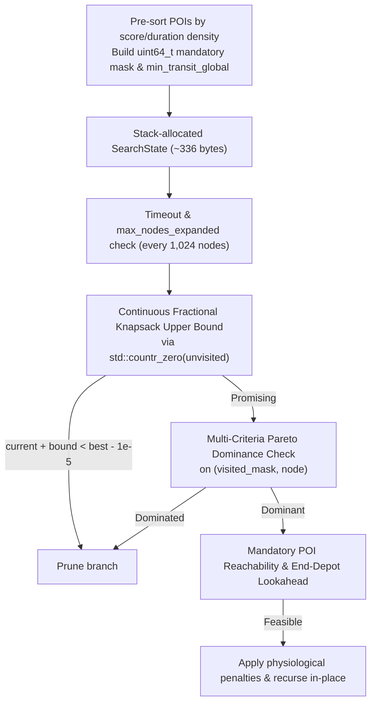

# C++20 combinatorial core (`paladio_core`)

`cpp_core/` implements three deterministic, GIL-releasing routing solvers in zero-dependency C++20 exposed to Python through `pybind11`: an exact Time-Constrained Orienteering Problem with Time Windows (TCOPTW) branch-and-bound optimizer (`optimize_itinerary`), a full-visit TSP tour heuristic (`solve_tsp_tour`), and a soft-time-window TSPTW re-optimizer (`solve_tsptw`).

## Why combinatorial optimization lives in C++20

Solving daily itineraries inside Python loops hits Global Interpreter Lock (GIL) contention and dynamic allocation overhead during deep search trees. Moving route optimization into `paladio::core` gives Paladio deterministic millisecond latency across concurrent trip requests while freeing Python threads via `py::gil_scoped_release`.

!!! note "Algorithmic scope of `cpp_core/`"
    All three solvers consume precomputed row-major flattened `N x N` transit duration (`int32`) and cost (`float64`) arrays supplied by Valhalla, GTFS, or Haversine matrices in Python. `cpp_core/` does not implement interval trees, spatial Haversine indices, Adaptive Large Neighborhood Search (ALNS), or Simulated Annealing.

## Exact TCOPTW solver (`optimize_itinerary`, $N \le 64$)

`optimize_itinerary` performs an exact Depth-First Branch & Bound search maximizing net utility score subject to monetary budget, hard opening/closing time windows, global end deadlines, mandatory stop inclusion, and human physiological rules.

- **Zero-copy DFS frame**: `SearchState` packs `uint64_t visited_mask`, `std::array<int, 64>` path and arrival buffers, category/taxonomy counters, fatigue minutes, and meal timestamps into roughly `336 bytes` on the stack, mutating and restoring fields in place without path heap allocations. (Pareto dominance memoization maps `(visited_mask, node)` buckets in `std::unordered_map<MemoKey, std::vector<MemoEntry>>`.)
- **Continuous fractional knapsack bound**: Unvisited nodes are traversed in descending `score / duration` density order using C++20 `<bit>` `std::countr_zero`, lower-bounding transit with `min_transit_global` and permitting one fractional final POI inside remaining time.
- **Multi-criteria Pareto dominance**: Prunes partial tours at `(visited_mask, u)` whenever an existing memoized state reaches `u` with `<= time`, `<= cost`, `>= score - 1e-5`, a superset of meal flags, `<= continuous_active_time`, and matching `last_meal_time`.
- **Physiological human-realism constraints**: Enforces `breakfast_deadline`, `lunch_deadline`, `dinner_deadline`, `min_meal_spacing`, `max_idle_time`, idle penalty (`idle_time / 15.0 * idle_time_penalty_rate`), `max_active_time_before_fatigue` reset on `HOTEL`/`BAR`/meals, and exponential category monotony damping across 16 `category_id` slots.
- **Lexicographical tie-breaking**: Maximizes `total_score` (epsilon `1e-5`), then minimizes `total_time`, then minimizes `total_cost`.

## Full-visit TSP and soft-window TSPTW re-optimizers

When you drag stops, lock anchors, and click **Solve** inside the workspace (`TripReoptimizationService`), every stop in that day must remain in the tour (`N` is unconstrained by the 64-bit mask limit):

1. **`solve_tsp_tour`**: Pins `start_node` (and optionally `end_node` when `fixed_end=True`), builds up to 4 multi-start Nearest-Neighbor tours from nearest first-hop neighbors, and refines them with asymmetric-safe **2-opt** (up to 100 passes) and **Or-opt** block relocations (`L = 1, 2, 3`, up to 20 passes each).
2. **`solve_tsptw`**: Initializes tours from **Earliest Deadline First (EDF)** plus up to 4 time-window Nearest-Neighbor starts, then runs up to 100 joint **2-opt** and **Or-opt** (`L = 1, 2`) passes minimizing total directed transit plus quadratic lateness penalties (`penalty_weight * (reach - window_end)^2`) and linear earliness wait penalties (`0.5 * (window_start - reach)`).

## Measured performance characteristics

Benchmarks documented in `cpp_core/docs/benchmarks.md` (Ryzen 7 7730U, GCC 13.3.0 `-O3 -DNDEBUG -march=native -fno-rtti`) show sub-millisecond solving on small daily graphs and predictable scaling under constrained time windows; in backend production calls, `max_nodes_expanded` (default `50,000` in Itinerary v2) and `timeout_ms` guard worst-case dense graphs by returning the best incumbent with `timed_out = true`.

| Graph size ($N$) | Window / density profile | Documented mean latency |
| :--- | :--- | :--- |
| $N = 10$ | Daily subgraph | `5.5 us` |
| $N = 25$ | Typical city day | `1.31 ms` mean (`2.05 ms` P95) |
| $N = 64$ | 4-hour window | `2.54 ms` |
| $N = 64$ | Dense full-day graph (unbounded) | `2.74 s` |

See [C++20 and Python API reference](../reference/cpp-python-api.md) for exact signatures and parameter defaults.
