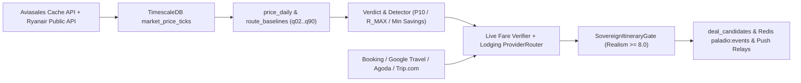

# Deal Engine and multi-modal transit architecture

Two self-hosted subsystems keep Paladio independent of commercial itinerary aggregators: a TimescaleDB-backed flight and lodging Deal Engine that scores packages against P10 quantile baselines and realism gates, and a 14-table local GTFS + Valhalla + 5-tier fare transit stack.

## Continuous flight and lodging Deal Engine

`backend/app/engine/market/` runs scheduled daily sweeps (`03:00 UTC`) and on-demand route backfills to catch statistically rare price drops rather than noisy promotional banners.

!!! warning "Experimental data scraping"
    While the quantile baseline, verdict, and itinerary gating pipeline is deterministic, the **flight and lodging data scraping** layer is currently experimental and subject to upstream provider changes.

- **Time-series quantile baselines**: `market_price_ticks` (TimescaleDB hypertable with compression) aggregates into `price_daily` and `route_baselines` across 6 booking lead-time buckets (`0–7`, `8–21`, `22–60`, `61–120`, `121–240`, `241+` days) with 7 quantiles (`q02`, `q05`, `q10`, `q25`, `q50`, `q75`, `q90`) over a 540-day window and hierarchical fallback (`full`, `drop_lead`, `drop_month`).
- **Lodging sharding and entity resolution**: `ShardPlanner`, `LodgingAggregator`, and `EntityResolver` query `BookingScraperProvider`, `GoogleTravelHotelsProvider`, `AgodaProvider`, `TripComProvider`, and `HistoryQuoteProvider` through `ProviderRouter` (circuit breakers at `5` failures / 24-hour cooldown and daily tier call budgets), deduplicating cross-provider hotels and scoring candidates via taste-aware weights (`price 0.30`, `quality 0.25`, `location 0.20`, `taste 0.15`, `flexibility 0.05`, `trust 0.05`).
- **Feasibility and realism gating**: Candidates passing `MIN_ABS_SAVINGS_CENTS` (`30.00` EUR), flight dead-window checks (`00:00–05:00` local), `MIN_ON_GROUND_HOURS` (`36` hours), and `LODGING_MIN_QUALITY` (`70.0`) must clear `SovereignItineraryGate` (`REALISM_MIN >= 8.0`) before firing alerts or pairing with public holidays (`DealPackageService`).

## Multi-modal transit and 5-tier fare engine

Paladio derives local transit feeds into indexed relational tables instead of keeping heavy graph engines loaded for every city on Earth simultaneously.

1. **Valhalla street graphs**: `OSMMapService` downloads OSM extracts into `valhalladata` (`/custom_files`), powering local walking, cycling, and driving legs plus `N x N` solver distance matrices.
2. **GTFS ingestion and 14-table derivation**: `GTFSResolverService` + `build_city_gtfs_task` fetch and sanitize feeds into `gtfsdata`, then `TransitDerivationService` normalizes agencies, lines, stations, patterns, stops, pattern trips, station-line links, service summaries, service calendar days, shapes, transfers, and fare tables directly in PostgreSQL (`transit_*`).
3. **Transitous live fallback**: `TransitousService` queries MOTIS transit routing with Redis caching whenever a destination lacks compiled local GTFS coverage (`UNAVAILABLE` in `transit_coverage`).
4. **5-tier `FareResolver`**: Estimates leg fares and daily pass recommendations (`get_transit_pass_advice`) from compiled GTFS fare rules, dedicated adapters (`Tokyo ODPT` and `London TfL`), and cited official `transit_fare_quotes` (reseeded by `scripts/migrate_verified_fares_to_quotes.py`).
