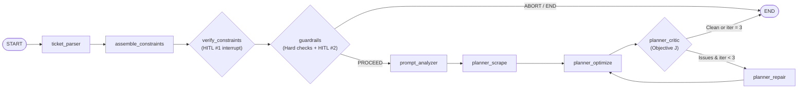

# Deterministic trip engine and LangGraph swarm

Paladio generates itineraries through a 9-node deterministic LangGraph state machine driving an 8-stage Itinerary v2 pipeline and a critic-repair refinement loop, combining LangGraph checkpointing with zero generative LLM reliance.

## The 9-node deterministic LangGraph swarm

Mounted at `app.state.graph` (`backend/app/swarm/graph.py`) and driven over `WS /api/ws/stream`, the swarm converts unstructured trip inputs and uploaded bookings into validated, realism-audited schedules.

| Swarm node | Deterministic responsibility | Key design note |
| :--- | :--- | :--- |
| `ticket_parser` | Extracts flight windows, IATA codes, and hotel anchors from booking text | Replaced earlier Pydantic AI LLM parsing with deterministic regex/date parsers |
| `assemble_constraints` | Normalizes dates, airports, budget, and depot fields into `TravelConstraints` | Validates structure via Pydantic before downstream DB or C++ execution |
| `verify_constraints` | Triggers LangGraph `interrupt({"type": "VERIFICATION_REQUIRED", …})` | Bypassed automatically when `auto_verify=True` |
| `guardrails` | Rejects past dates, return < start, identical origin/dest, or trips > 30 days; raises `TRIP_OVERLAP_WARNING` interrupt on DB date collision | Prevents infeasible or accidentally overlapping trips before scraping |
| `prompt_analyzer` | Runs `PromptIntentExtractor` (ONNX 768-D anchor projection + `rapidfuzz` POI matching) and merges participant taste vectors | Extracts tastes, cuisines, pace, and mandatory POIs in milliseconds with zero LLM tokens |
| `planner_scrape` | Executes `FetchTravelContextUseCase` to ensure destination city POIs, ratings, and embeddings exist | Hydrates missing city data dynamically from OSM and Wikimedia |
| `planner_optimize` | Executes `OptimizeDailyItineraryUseCase` running the 8-stage Itinerary v2 pipeline | Dispatches per-day subgraphs concurrently into C++20 `paladio_core` |
| `planner_critic` | Audits realism issues (`MISSING_TIER_1`, `DAY_OVERLOADED`, `DAY_UNDERLOADED`, `MEAL_GAP`, `EXCESSIVE_TRANSIT`, `IDLE_GAP`, `ZIGZAG_ROUTING`) and scores `J` | Evaluates 2-opt geometry (`zigzag ratio > 1.25`) to catch ping-pong routes |
| `planner_repair` | Applies targeted deterministic fixes and re-routes to `planner_optimize` | Bounded at `MAX_REFINEMENT_ITERATIONS = 3` |

!!! warning "Checkpointer volatility across backend restarts"
    `create_swarm()` uses LangGraph's in-memory `MemorySaver` by default. If `api` restarts mid-generation while paused at a `VERIFICATION_REQUIRED` or `TRIP_OVERLAP_WARNING` interrupt, resume requires starting a fresh trip generation request from `/engine`.

## Objective score $J$ in `planner_critic`

`evaluate_itinerary_quality` in `backend/app/swarm/critic.py` quantifies itinerary realism deterministically after each optimization pass:

$$
J = (\text{total\_sights} \times 100.0) - (\text{total\_travel\_mins} \times 1.5) - \left(\sum_{i \in \text{issues}} i.\text{severity} \times 50.0\right) \times \frac{\text{critic\_strictness}}{0.75}
$$

## The 8-stage Itinerary v2 pipeline

Inside `backend/app/engine/pipeline.py`, `run_itinerary_v2_pipeline` breaks multi-day trip planning into eight composable stages so C++ branch-and-bound sees compact, well-clustered daily subgraphs (`N <= 64`) rather than an intractable city-wide graph:

1. **Trip frame (`build_trip_frame`)**: Computes usable daily time windows from flight arrival/departure hours, hotel depot coordinates (defaulting to the coordinate-wise median of Tier 1/2 sights if unanchored), pace caps, and local dining rhythms (`compute_city_rhythm_profile`).
2. **Candidate pool (`build_candidate_pool`)**: Gathers 100% of Tier 1/2 sights, top personalized POIs scored by 768-D taste similarity + hybrid quality, mandatory stops, and candidate meal venues.
3. **Trip-level submodular selection (`select_trip_pois`)**: Locks mandatory and iconic stops first, then runs submodular greedy selection balancing category diversity against utility.
4. **Day assignment (`assign_pois_to_days`)**: Groups sights into walking bundles and anchor seeds using regret-2 insertion and Hungarian assignment so neighboring POIs share the same day.
5. **Budget allocation (`allocate_trip_budget`)**: Distributes available discretionary budget pro-rata across active days using live FX conversions.
6. **Parallel C++20 daily solving (`solve_trip_v2`)**: Flattens each day's Valhalla/transit matrices and invokes `paladio_core.optimize_itinerary` across threads (`asyncio.to_thread` with GIL released), returning exact `arrival_times`.
7. **Budget slack redistribution**: Reallocates unspent budget headroom from lighter days to days constrained by paid admissions.
8. **Explainable synthesis**: Attaches day themes, selection reason codes, and an explicit list of `dropped_pois` explaining why omitted venues did not fit.
