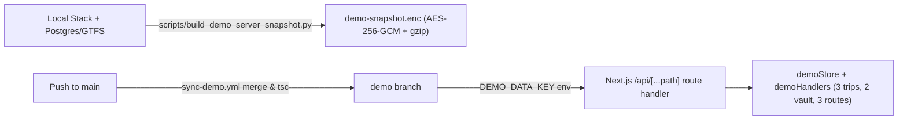

# Frontend architecture, PWA offline mode, and Demo branch

Built with Next.js 16 (`output: 'standalone'`), React 19, Vanilla CSS Modules, Leaflet + MapLibre GL, and 7 Zustand stores, the frontend provides a localized multi-theme workspace with IndexedDB offline persistence plus an encrypted standalone `demo` deployment mode.

## Pacific Jazz styling, state management, and map stack

Paladio avoids heavy UI component frameworks in favor of CSS custom properties in `frontend/src/app/globals.css` paired with scoped `*.module.css` files and zero-flicker head theme hydration in `layout.tsx`.

- **Design system**: Supports 3 themes (**Pacific Jazz Light**, **Pacific Jazz Dark**, **Silent Waters**), 2 typography scales (**Inter** vs **Classic** Jost + Inter + JetBrains Mono), and 2 navigation shells (**Sidebar** vs **FloatingDock**), plus custom tactical SVG illustrations under `frontend/src/components/illustrations/`.
- **7 Zustand stores (`frontend/src/stores/`)**: `localeStore`, `themeStore`, `typographyStore`, `navigationStore`, `sidebarStore`, `notificationStore` (100-item per-user inbox), and `tripDraftStore` (`/engine` form draft persistence), alongside 3 React contexts (`AuthContext`, `I18nContext`, `SocketContext`).
- **2D vector + cluster cartography**: Combines `leaflet` + `react-leaflet` + `react-leaflet-cluster` with `maplibre-gl` (`VectorBasemap.tsx` using `public/worker/maplibre-gl-worker.mjs` to strip 3D extrusions and visual clutter from OpenFreeMap `liberty` tiles) and selectable raster basemaps (`OSM`, `Carto Voyager`, `Carto Dark`, `Satellite`).

## 10-locale internationalization and RTL layout

Every user-facing string runs through `useTranslation()` (`t(...)`), validated across all 10 dictionary files (`en`, `es`, `fr`, `de`, `it`, `pt`, `ja`, `zh-CN`, `ko`, `ar`) by `scripts/i18n/validate_locales.py`.

- `en.json` ships bundled as the default fallback with an English-to-key reverse fallback map in `localeStore.ts`; the remaining 9 dictionaries lazy-load from `/locales/{code}.json`.
- Selecting Arabic (`ar`) switches `<html dir="rtl">` dynamically across layouts, calendars, and modals.

## Service Worker and IndexedDB offline trip pinning

For reliable field use without roaming connectivity, `PwaRegistration.tsx` registers `frontend/public/sw.js` alongside `frontend/src/utils/offlineStore.ts`:

- **Service Worker caches**: Uses cache-first caching (`paladio-shell-v1`) for `/_next/static/` assets and network-first with cache fallback (`paladio-data-v1`) for `/api/trips` and OpenFreeMap/OSM/Carto map tiles.
- **Explicit offline trip pinning**: Clicking the header pin icon inside `/trips/[id]` (`pinTripOffline(tripId)`) stores the full trip JSON, Wallet passes, raw ticket file attachments, and trip expenses in IndexedDB.

## How the standalone `demo` branch works

The public interactive preview lives on a separate **`demo` branch** kept automatically synchronized with `main` by `.github/workflows/sync-demo.yml` (and guarded locally by `scripts/guard_demo_branch.sh` in pre-commit).

- On `demo`, Next.js intercepts `/api/*` requests through `frontend/src/app/api/[...path]/route.ts`, decrypts `frontend/src/server/demo-snapshot.enc` with `DEMO_DATA_KEY`, and serves realistic PostgreSQL-captured trips, GTFS stations, and route telemetry in memory without requiring Docker Postgres, Redis, or Valhalla containers.
- Writes inside the demo reset cleanly on schedule (`DemoResetTimer`) while keeping admin secrets and destructive infrastructure routes gated (`DemoFeatureGate`).
