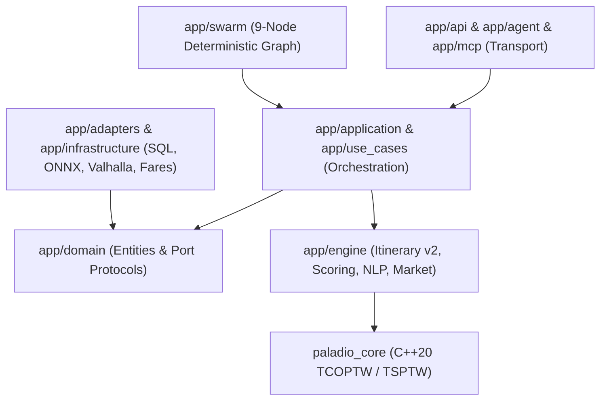

# System architecture overview

Paladio separates deterministic travel planning, mathematical route optimization, and local semantic search from optional conversational Large Language Model (LLM) interfaces across a 7-container self-hosted stack and a Clean Architecture backend.

## Why deterministic planning replaces end-to-end LLM chains

Earlier iterations delegated booking parsing, constraint extraction, and route scoring to local LLM calls and an untrained JAX Multi-Layer Perceptron (MLP), which introduced non-deterministic schedules, latency spikes, and arithmetic errors. Paladio now enforces a strict architectural split:

- **Deterministic generation and optimization**: Booking text parsing, constraint assembly, 768-dimensional semantic embedding (`fastembed` CPU ONNX), multi-attribute ranking (`HybridSovereignScorer`), and daily itinerary scheduling (`paladio_core` C++20) run without generative LLM calls.
- **Optional conversational orchestration**: Generative LLMs (13 supported providers) are isolated strictly inside `TripAgentRunner` (`backend/app/agent/`) for `Plan -> Agent` chat, calling verified deterministic tools through the Model Context Protocol (MCP) server under strict human-in-the-loop confirmation gates.

## Clean Architecture backend boundaries

The backend (`backend/app/`) enforces dependency inversion so domain entities and solvers stay decoupled from FastAPI routers, SQLAlchemy ORM sessions, and external HTTP scrapers.

| Layer | Responsibility | Key modules |
| :--- | :--- | :--- |
| **Domain** | Pure entities (`City`, `Poi`, `Taste`), 10 repository/provider port protocols, ISO currency codes | `backend/app/domain/` |
| **Application & Use Cases** | Trip editing, revision snapshots, expense settlement, participants, tickets, collections, taste service | `backend/app/application/`, `backend/app/use_cases/` |
| **Core Engine** | 8-stage Itinerary v2 pipeline, `PromptIntentExtractor`, SQL RRF retrieval, `HybridSovereignScorer`, Deal Engine | `backend/app/engine/` |
| **Swarm** | 9-node deterministic LangGraph state machine with 2 `interrupt()` human-in-the-loop checkpoints | `backend/app/swarm/` |
| **Adapters & Infrastructure** | Async SQLAlchemy repositories, `OnnxEmbeddingProvider`, OSM/PBF/Wikimedia ingest, `CppOptimizationAdapter` | `backend/app/adapters/`, `backend/app/infrastructure/` |
| **Transport & Workers** | 15 FastAPI routers, 2 WebSockets, FastMCP `/mcp` mount, and 18 Celery tasks across 3 queues | `backend/app/api/`, `backend/app/agent/`, `backend/app/mcp/`, `backend/app/tasks.py` |

## Dynamic data invariant and zero-legacy policy

Two repository-wide engineering invariants shape every subsystem in Paladio:

1. **Dynamic data everywhere**: Production paths across the frontend, backend, swarm, and C++ core never emit mock itineraries, synthetic fallback POIs, or hardcoded pricing catalogs. Data is loaded dynamically from PostgreSQL 16 (TimescaleDB + `pgvector`), OpenStreetMap/Wikidata/Wikimedia, Valhalla/GTFS feeds, live exchange rates, or user input, failing fast when required data is missing.
2. **Zero legacy compatibility shims**: Routes, schemas, and storage tables evolve cleanly in place without `/api/v1` version aliases, schema synonym fields, or backward-compatibility wrappers (for example, the obsolete `city_transit_fares` table was dropped outright in favor of the normalized 14-table GTFS + `transit_fare_quotes` design).
