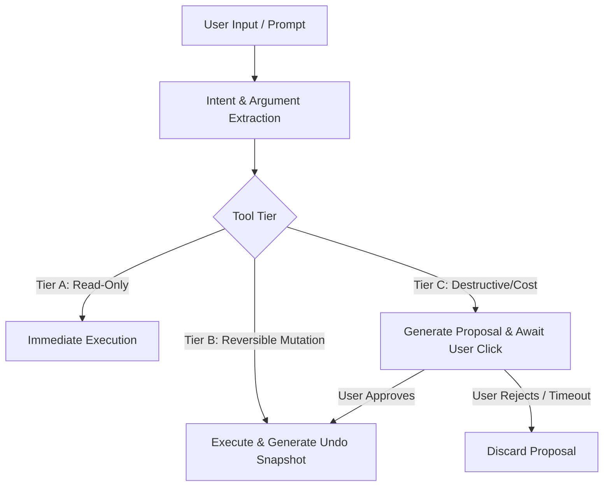

# Explanation: Agent Safety & Sovereign Security Model

## Core Philosophy: The Sovereign Guardrail

Paladio's Trip Agent operates in a personal, self-hosted, multi-traveler environment. Because LLMs are non-deterministic and susceptible to prompt injection or hallucination, Paladio enforces an architectural safety perimeter:

> **The Model Proposes; The C++ Engine & User Validate.**
> 1. LLMs are strictly restricted to semantic classification and parameter extraction. Combinatorial optimization, schedule feasibility, and distance calculations are executed deterministically in C++20 (`paladio_core`).
> 2. No mutation is committed without passing database authorization checks, Pydantic model validation, and optimistic revision locks.

---

## 1. Multi-Tier Permission Hierarchy

Tools are partitioned into three immutable security tiers:



### Tier A (Query / Read-Only)
- Pure queries with zero write operations (`get_trip_overview`, `get_itinerary`, `list_expenses`).
- Enforces `TripAccessLevel.VIEWER`.

### Tier B (Direct Reversible Mutation)
- Add, move, or re-sequence waypoints within existing days.
- Every mutation records a complete snapshot in `trip_revisions` and generates a reversible `undo_token`.
- Enforces `TripAccessLevel.EDITOR`.

### Tier C (Destructive / Cost / Rebalance)
- Actions that delete entire days, rebalance multi-day itineraries, or finalize payments.
- Blocked from automatic execution by the model. The server returns a `ProposalData` structure with a strict TTL (typically 5 minutes).
- Changes are only applied when the user explicitly clicks **Approve** in the client interface, transmitting the cryptographically unforgeable proposal ID back over the WebSocket.

---

## 2. Optimistic Concurrency & Revision Control

To prevent race conditions between collaborating users and agent turns:
1. Every trip has an integer `revision` column.
2. Every mutation executes a Compare-And-Swap (CAS) update:
   ```sql
   UPDATE trips
   SET itinerary_data = :new_data, revision = revision + 1
   WHERE id = :trip_id AND revision = :expected_revision;
   ```
3. If concurrent edits occur, the update fails with `409 Conflict`, triggering an automatic re-fetch rather than silently overwriting user work.

---

## 3. Defense Against Prompt Injection & IDOR

1. **In-Process Access Verification**: Every tool invocation validates the user's role on the specific `trip_id`. An attacker cannot prompt the agent to read or modify another user's trip because all SQL queries are scoped to the authenticated traveler's access matrix.
2. **Secret Redaction**: Passwords, ticket barcodes, and access PINs are masked at the service boundary (`mask_secret()`), ensuring raw secrets never enter the LLM context window where they could be leaked.
3. **No Self-Approval**: Proposals are stored in Redis with UUID keys. The model cannot pass `confirmed=True` for a Tier C tool on its own; confirmation tokens are only accepted when signed by the user's client session.

---

## 4. Comprehensive Audit Trail

Every MCP action is written to the `agent_actions` table:
- `timestamp`, `tool`, `outcome` (success / failure / rejected)
- `user_id` and `trip_id`
- JSON payload of exact input arguments
- Resulting database `revision` number

This guarantees 100% post-facto auditability for all automated and semi-automated itinerary changes.
