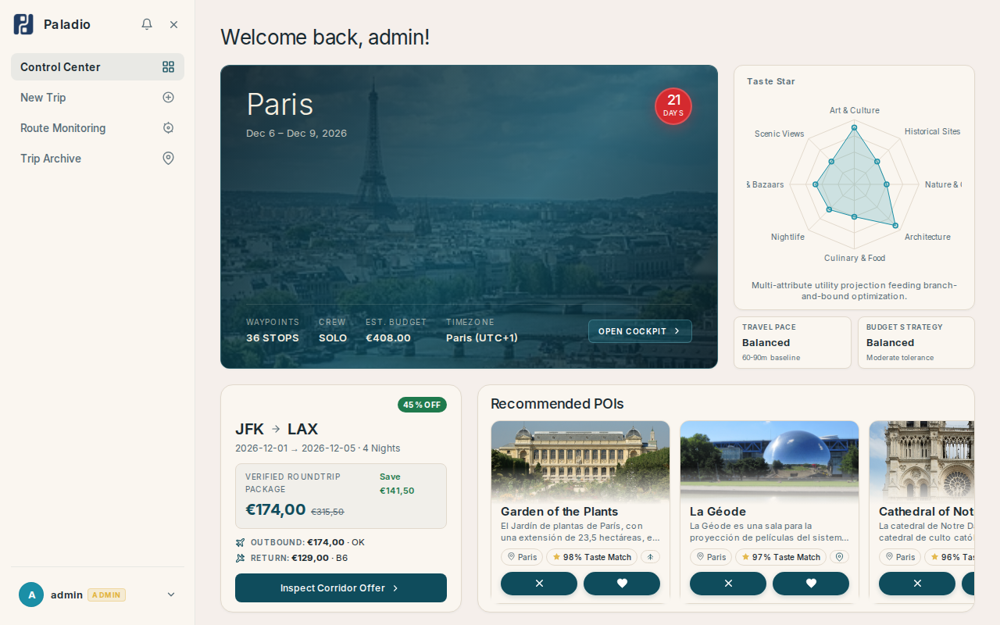
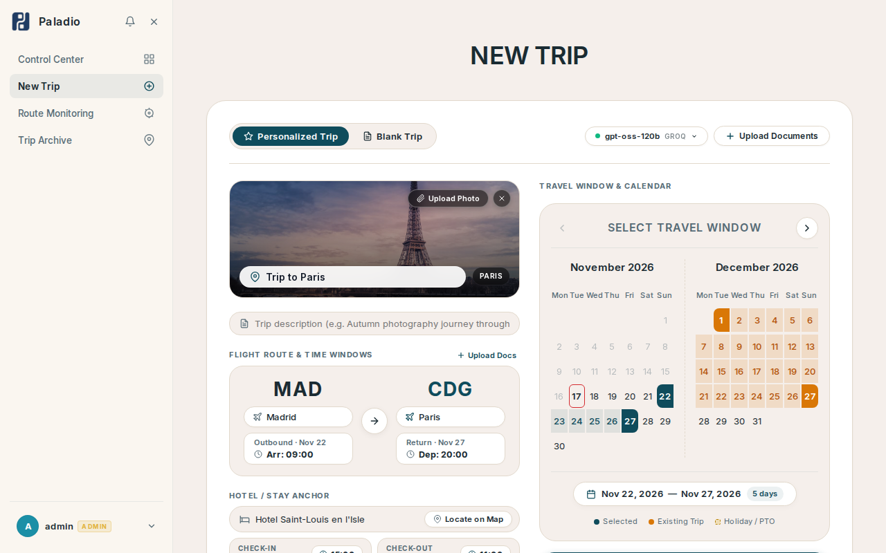

# Quickstart: plan your first trip

Sign into your new Paladio instance, initialize your 8-axis Taste Star profile at `/taste-calibration`, and generate your first deterministic itinerary in New Trip (`/engine`) without needing any external generative AI key.

## Calibrate your 8-axis Taste Star

New accounts start with a neutral taste vector (0.5 across all dimensions), which displays a calibration banner on Control Center (`/dashboard`). Completing `/taste-calibration` seeds your personal 768-dimensional preference profile for Point of Interest (POI) matching before you generate a trip.

1. Click the **Seed Your Taste** banner on `/dashboard` (or navigate to `http://localhost:3000/taste-calibration`).
2. Answer the 8 scenario questions (`first_morning`, `afternoon_pace`, `urban_form`, `dining_style`, `after_sunset`, `markets_craft`, `budget_strategy`, and `crowd_discovery`) or skip any question you want to leave neutral.
3. Submit your answers to update your `UserTasteProfileModel` and view your updated **Taste Star** radar (`art_culture`, `history_heritage`, `nature_outdoors`, `architecture`, `food_culinary`, `nightlife`, `shopping`, and `scenic_views`) on `/dashboard`.

## Create a personalized trip in `/engine`

Opening **New Trip** (`/engine`) lets you choose between **Personalized Trip** (runs the deterministic LangGraph swarm and `paladio_core` C++20 optimizer) and **Blank Trip** (opens an empty workspace for manual curation).

1. Select **Personalized Trip** in the mode toggle at the top of `/engine`.
2. Fill in your **ORIG** and **DEST** city/airport codes and arrival/departure hours in the route intake bar so Day 1 and the final day respect airport transfer windows.
3. Select your travel dates in the date range picker, set your hotel stay anchor (either by hotel search or by dropping a map pin), and enter your target budget with the currency wheel picker.
4. Optionally add fellow travelers in the Crew Roster or upload flight and hotel confirmation files (`PDF`, `PNG`, `JPG`, `WEBP`, `TXT`, `.pkpass`, or `.trip`) via the upload modal for automatic local parsing.
5. Describe your preferences in the intent box (for example, `Quiet museums, historic neighborhoods, specialty coffee, and late tapas`) and click **Generate Sovereign Trip Plan**.

## Review live swarm telemetry and verification checkpoints

Paladio connects over `WS /api/ws/stream` and streams real-time progress through the `ThinkingScreen` while the 9-node deterministic swarm hydrates city POIs and computes travel matrices.

1. When the **Verification Required** modal appears (`verify_constraints` human-in-the-loop checkpoint), confirm the extracted origin, destination, dates, budget, and hotel anchor, or adjust any field before proceeding.
2. If your new dates overlap an existing trip in PostgreSQL, resolve or acknowledge the **Trip Overlap Warning** modal (`guardrails` checkpoint).
3. Wait for `planner_scrape`, `planner_optimize` (`paladio_core.optimize_itinerary`), `planner_critic`, and `planner_repair` to complete and redirect you automatically to `/trips/[id]`.

!!! note "Zero LLM keys required for trip generation"
    All 9 swarm nodes (`ticket_parser`, `assemble_constraints`, `verify_constraints`, `guardrails`, `prompt_analyzer`, `planner_scrape`, `planner_optimize`, `planner_critic`, `planner_repair`) execute deterministically using regex parsers, CPU ONNX embeddings, and C++20 branch-and-bound search. Generative LLM API keys are needed only if you later enable the optional interactive chat assistant inside `Plan -> Agent`.

## Inspect and refine your generated itinerary

Your trip opens in the full-screen Trip Workspace (`/trips/[id]`), pairing an interactive 2D architectural map on the right with a 6-tab sidebar on the left (`Route`, `Search`, `Transit`, `Weather`, `Collections`, `Agent`).

1. Switch between **ALL DAYS** and individual day pills (`DAY 1`, `DAY 2`, …) in the **Route** tab to inspect stop times, meal windows, and walking or transit leg connectors.
2. Click the bottom-left **Speed Dial (`+`)** button and toggle **EDIT ROUTE** to lock fixed-time reservations, drag stops to reorder a day, or delete stops.
3. Click **Solve** to re-run the C++20 Time-Constrained Orienteering Problem with Time Windows (TCOPTW) / TSPTW solver around your locked anchors.

Next, learn every panel of the workspace in [Control Center and Taste Star](../user-guide/control-center-and-taste.md) and [Trip Workspace and editing](../user-guide/trip-workspace.md).
