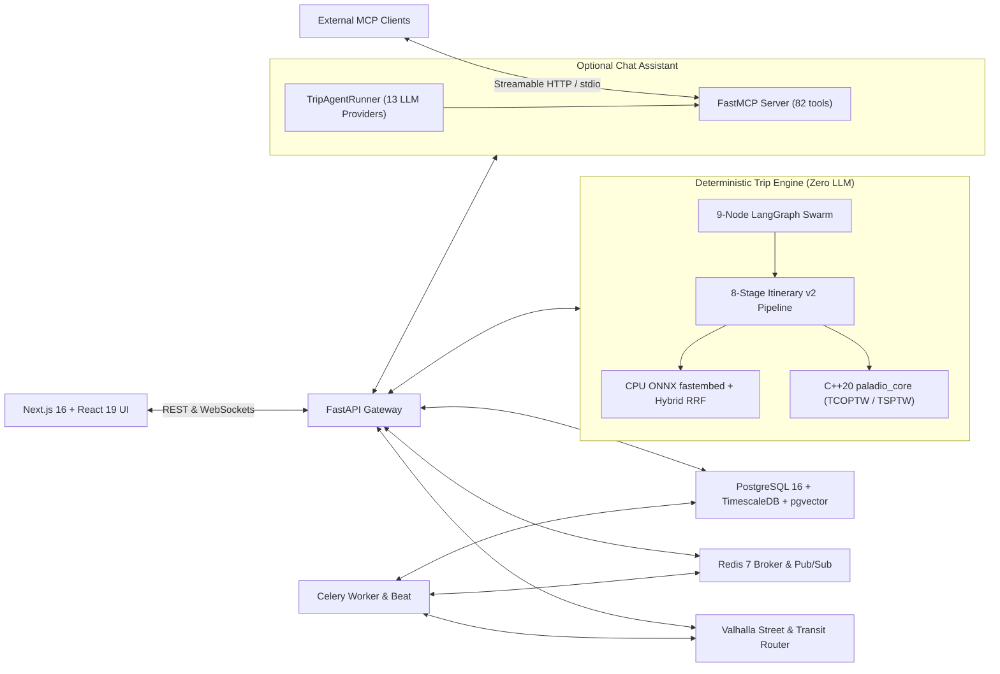

# Paladio documentation

Paladio is a self-hosted travel planning, route optimization, and fare telemetry platform built with FastAPI, Next.js 16, PostgreSQL 16 (with TimescaleDB and pgvector), Redis, Celery, Valhalla, and a C++20 combinatorial core (`paladio_core`). Trip generation, booking parsing, and 768-dimensional semantic search run deterministically on local infrastructure without external generative Large Language Model (LLM) APIs, while an optional interactive assistant supports 13 LLM providers and an 82-tool Model Context Protocol (MCP) server.

-   :material-rocket-launch:{ .lg .middle } **Getting started**

    Deploy the 7-container Docker stack, run first-time provisioning at `/setup`, calibrate your 8-axis Taste Star, and compile `paladio_core` locally.

    [:octicons-arrow-right-24: Start with installation](getting-started/installation.md)

-   :material-compass-outline:{ .lg .middle } **User guide**

    Explore Control Center, New Trip creation, the Trip Workspace map and Speed Dial, public transit GTFS, the Bookings Wallet, Route Monitoring, Costs, Trip Archive, and the optional AI assistant.

    [:octicons-arrow-right-24: Explore the user guide](user-guide/control-center-and-taste.md)

-   :material-server-security:{ .lg .middle } **Self-hosting and operations**

    Configure `.env` bootstrap keys and `/config` dynamic settings, manage city POI and GTFS storage, set up reverse proxies, integrate Immich or Synology, and maintain backups.

    [:octicons-arrow-right-24: Read operator runbooks](self-hosting/configuration.md)

-   :material-sitemap-outline:{ .lg .middle } **System architecture**

    Inspect the 8-stage deterministic Itinerary v2 pipeline, 9-node LangGraph swarm, C++20 TCOPTW branch-and-bound solver, CPU ONNX retrieval, and Deal Engine architecture.

    [:octicons-arrow-right-24: Study the architecture](architecture/system-overview.md)

-   :material-book-open-page-variant-outline:{ .lg .middle } **Technical reference**

    Look up exact REST endpoints, WebSocket message schemas, all 82 MCP tools, 54 database tables, 18 Celery tasks, C++20/Python signatures, and the `.trip` archive schema.

    [:octicons-arrow-right-24: Browse technical reference](reference/rest-api.md)

-   :material-code-braces:{ .lg .middle } **Contributing**

    Follow Paladio's dynamic-data and zero-legacy engineering rules, 10-locale translation parity checks, pre-commit hooks, and GitHub Wiki sync workflow.

    [:octicons-arrow-right-24: Read the developer guide](contributing/developer-guide.md)

## Platform architecture at a glance

Paladio separates probabilistic language interfaces from deterministic route scheduling so travel times, opening hours, meal spacing, and budget limits remain provably valid across every edit.

## Core capabilities

| Capability | Runtime engine | Key implementation detail |
| :--- | :--- | :--- |
| **Deterministic trip generation** | LangGraph Swarm + Itinerary v2 + `paladio_core` | 9 LLM-free swarm nodes, 2 human-in-the-loop checkpoints, C++20 branch-and-bound TCOPTW solver (`N <= 64`) |
| **Semantic POI search and taste learning** | `fastembed` CPU ONNX + `HybridSovereignScorer` | `nomic-ai/nomic-embed-text-v1.5-Q` (768-D) + pgvector HNSW + SQL RRF + online SGD ranker |
| **Multi-modal street and transit routing** | Self-hosted Valhalla + Transitous + local GTFS | Compiled OSM road graphs, 14-table derived PostgreSQL GTFS schedules, 5-tier fare resolution |
| **Bookings Wallet and document scanning** | `zxing-cpp` + Tesseract OCR + Fernet | Parses PDFs, images, `.pkpass` bundles, and IATA BCBP barcodes locally with encrypted ticket secrets |
| **Route price and hotel telemetry** | TimescaleDB + Celery Beat + `ProviderRouter` | Sweeps Aviasales, Ryanair, Booking, Google Travel, Agoda, and Trip.com against P10 quantile baselines |
| **Interactive AI assistant and MCP** | `pydantic-ai` (`TripAgentRunner`) + FastMCP | Optional across 13 LLM providers; 82 tools, 6 resources, 6 prompts, Tier C confirmation proposals, and revision undo |
| **Portability, offline PWA, and sync** | `.trip` ZIP archives + IndexedDB + Vault Sync | `Full Vault` or sanitized `Shareable` `.trip` packages, `.pdf`/`.ics`/`.gpx`/`.json` exports, Immich and Synology sync |

## Documentation portals

Paladio ships three synchronized documentation surfaces so end users, homelab operators, and contributors can each reach verified answers without leaving their environment:

- **Documentation site**: Built with Material for MkDocs from `docs/` and published to [leandro-juan.github.io/paladio](https://leandro-juan.github.io/paladio/).
- **GitHub Wiki**: Generated directly from `mkdocs.yml` via `scripts/sync_wiki.py` at [github.com/Leandro-Juan/paladio/wiki](https://github.com/Leandro-Juan/paladio/wiki).
- **In-app Help Center**: Embedded inside the web UI at `/help` with 10 categories, 22 articles, screenshots, and interactive mockups translated across all 10 shipped locales.
