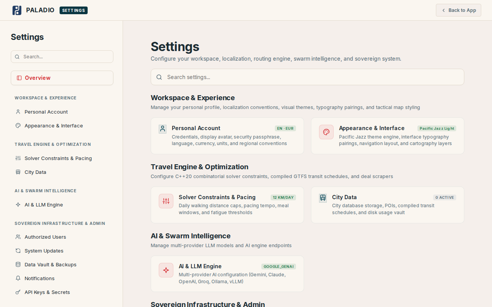

# Configuration and environment variables

Paladio splits configuration cleanly between static bootstrap credentials in `.env` (for PostgreSQL, JWT signing, wallet encryption, and container networking) and dynamic runtime settings stored in PostgreSQL `system_config` via **Settings** (`/config`).

## How `.env` and `/config` work together

Keep root infrastructure secrets in `.env`, then manage solvers, LLM providers, backups, photo sync, notifications, and Travelpayouts keys directly inside `/config` so changes take effect without editing compose manifests.

| Settings category in `/config` | Sections included | Access level |
| :--- | :--- | :--- |
| **Workspace & Experience** | **Personal Account** (profile, avatar, password, language, base currency, units, clock, date format, holiday country) and **Appearance & Interface** (3 Pacific Jazz themes, Inter/Classic typography, Sidebar/Dock navigation, 4 cartography layers) | Any signed-in user |
| **Travel Engine & Optimization** | **Solver Constraints & Pacing** (walking cap, tempo, meal windows, fatigue thresholds) and **City Data** (POIs, Valhalla OSM tiles, compiled GTFS feeds, disk vault) | Admin only |
| **AI & Swarm Intelligence** | **AI & LLM Engine** (13 optional chat LLM providers, hardware RAM profile, Ollama unload) | Admin only |
| **Sovereign Infrastructure & Admin** | **Authorized Users**, **System Updates**, **Data Vault & Backups** (snapshots + Immich/Synology photo sync), **Notifications** (Pushify, Pushover, Ntfy, Custom Webhooks), and **API Keys & Secrets** | Admin only |

## Core database, authentication, and storage variables

Set these variables in `.env` (or container environment overrides) before running `docker compose up -d` in production.

| Variable | Default | Required in production | Purpose |
| :--- | :--- | :--- | :--- |
| `POSTGRES_USER` | `postgres` | Yes | PostgreSQL database superuser or application role name |
| `POSTGRES_PASSWORD` | `postgres` | Yes | PostgreSQL password (generated automatically by `scripts/install/install.sh` / `scripts/install/install.ps1`) |
| `POSTGRES_DB` | `paladio` | Yes | Primary PostgreSQL database holding TimescaleDB and `pgvector` tables |
| `DATABASE_URL` | Compose DSN | Yes (non-Docker) | Async SQLAlchemy connection string (`postgresql+asyncpg://…`) |
| `POSTGRES_HOST` | `db` | Compose default | Hostname used by helper scripts and health probes |
| `REDIS_URL` | `redis://redis:6379/0` | Yes | Redis broker, result backend, pub/sub channels, and locks |
| `ENVIRONMENT` | `development` (`production` in Compose/installer) | Set `production` | Controls strict production checks when `.jwt_secret` / `.wallet_key` cannot be persisted |
| `JWT_SECRET_KEY` | Persisted `.local/data/.jwt_secret` (local) / `/data/.jwt_secret` (Docker) | Yes (or writable `/data`) | HS256 signing secret (generate with `openssl rand -hex 32`) |
| `JWT_SECRET_PATH` | `.local/data/.jwt_secret` (local) / `/data/.jwt_secret` (Docker) | No | Fallback secret file path (`0600`) when `JWT_SECRET_KEY` is unset |
| `ACCESS_TOKEN_EXPIRE_MINUTES` | `1440` | No | JWT token lifetime in minutes (`1440` = 24 hours) |
| `WALLET_ENCRYPTION_KEY` | Persisted `.local/data/.wallet_key` (local) / `/data/.wallet_key` (Docker) | Yes (or writable `/data`) | Fernet symmetric key protecting Bookings Wallet secrets (`access_code`, Wi-Fi keys) |
| `WALLET_ENCRYPTION_KEY_PATH` | `.local/data/.wallet_key` (local) / `/data/.wallet_key` (Docker) | No | Fallback Fernet key file path (`0600`) when `WALLET_ENCRYPTION_KEY` is unset |
| `API_WORKERS` | `1` | No | Uvicorn worker count for the prebuilt `api` image (keep `1` on 4–8 GB hosts to avoid duplicating ONNX memory) |
| `ALLOWED_ORIGINS` | Dynamic localhost + RFC-1918 LAN / `.local` regex | Yes (custom public domain) | Comma-separated CORS allowlist overriding the default local/LAN origin rules |
| `ALLOW_PUBLIC_REGISTRATION` | `false` | No | Enables public signup via `POST /api/auth/register` after the initial admin exists |
| `PALADIO_API_TOKEN` | Unset | For MCP `stdio` | Bearer secret used when running `python -m app.mcp` over `stdio` |
| `API_PORT` / `FRONTEND_PORT` | `8000` / `3000` | No | Host port overrides read at runtime by `docker-compose.yml` and Next.js `RootLayout` |
| `PALADIO_PUBLIC_API_URL` | Unset (auto-derived from browser host + `API_PORT`) | Reverse proxy setups | Full public API base URL injected at runtime (e.g. `https://paladio.example.com/api`) |
| `PALADIO_VERSION` | `latest` | No | Image tag for `paladio-api` and `paladio-frontend` in `docker-compose.yml` |
| `PALADIO_API_IMAGE` / `PALADIO_FRONTEND_IMAGE` | `ghcr.io/leandro-juan/paladio-api` / `ghcr.io/leandro-juan/paladio-frontend` | No | Registry image overrides for `migrate`/`api`/`worker`/`beat` and `frontend` in `docker-compose.yml` |
| `VALHALLA_TILE_URLS` | Monaco Geofabrik seed extract | No | Initial `.osm.pbf` URL(s) compiled by `valhalla` when `/custom_files` is empty |
| `PALADIO_DATA_DIR` | `.local/data` (repo) / `/data` (Docker `appdata` volume) | No | Base runtime directory for `.jwt_secret`, `.wallet_key`, `trip_photos`, `wallet_attachments`, and Celery Beat schedule |
| `PHOTO_STORAGE_DIR` | `$PALADIO_DATA_DIR/trip_photos` (`/data/trip_photos` in Docker) | No | Disk directory for uploaded trip gallery photos |
| `WALLET_STORAGE_DIR` | `$PALADIO_DATA_DIR/wallet_attachments` (`/data/wallet_attachments` in Docker) | No | Disk directory for uploaded boarding pass PDFs and images |

## Geographic routing, ONNX embeddings, and translation variables

Tune local pathfinding, CPU semantic vector inference, and optional translation endpoints through these variables.

| Variable | Default | Purpose |
| :--- | :--- | :--- |
| `VALHALLA_URL` | `http://valhalla:8002` | Self-hosted Valhalla HTTP router (`http://localhost:8002` outside Compose) |
| `OSM_PBF_DIR` | `/custom_files` | Shared volume path where downloaded OpenStreetMap PBF extracts live |
| `GTFS_BASE_DIR` | `/gtfs_feeds` | Shared volume path storing downloaded and sanitized city GTFS ZIP feeds |
| `TRANSITOUS_URL` | `https://api.transitous.org/api/v2` | Fallback MOTIS public transit routing server when a city has no local GTFS feed |
| `FASTEMBED_MODEL` | `nomic-ai/nomic-embed-text-v1.5-Q` | Quantized ONNX model used for 768-dimensional semantic vectors |
| `FASTEMBED_CACHE_PATH` | `/opt/models/fastembed` | Pre-baked container directory holding downloaded ONNX weights |
| `FASTEMBED_THREADS` | `2` | CPU intra-op thread cap for in-process ONNX inference |
| `FASTEMBED_OFFLINE` | Unset | Set `true` to prevent any outbound Hugging Face hub download checks |
| `FASTEMBED_IDLE_TIMEOUT_SECONDS` | Unset | Idle timeout in seconds before `OnnxEmbeddingProvider` unloads weights from RAM |
| `PALADIO_TASTE_PERSONALIZATION_ENABLED` | `true` | Set `false` to disable personalized taste re-ranking globally |
| `DEEPL_API_KEY` | Unset | Optional DeepL API key for translating POI descriptions |
| `LIBRETRANSLATE_URL` / `LIBRETRANSLATE_API_KEY` | Unset | Optional self-hosted LibreTranslate fallback URL and key |
| `ODPT_API_KEY` / `ODPT_CONSUMER_KEY` / `ODPT_BASE_URL` | Unset | Optional Tokyo Open Data Challenge (`ODPT`) transit fare adapter credentials |
| `APP_VERSION` / `GITHUB_REPO` / `GITHUB_TOKEN` | Code version / `Leandro-Juan/paladio` | Overrides for the in-app GitHub release auto-updater |

## Optional chat agent LLM environment overrides

Although **Settings** (`/config` under **AI & LLM Engine**) stores active provider settings in PostgreSQL `system_config`, you can also supply keys through environment variables.

| Variable | Purpose |
| :--- | :--- |
| `LLM_PROVIDER` / `LLM_MODEL` / `LLM_API_KEY` / `LLM_BASE_URL` | Explicit active provider override (`openai`, `anthropic`, `google`, `groq`, `deepseek`, `mistral`, `openrouter`, `xai`, `perplexity`, `together`, `cerebras`, `custom_openai`, `ollama`) |
| `OLLAMA_BASE_URL` | Local or LAN Ollama endpoint (default `http://localhost:11434/v1`) |
| `OPENAI_API_KEY`, `ANTHROPIC_API_KEY`, `GEMINI_API_KEY`, `GOOGLE_API_KEY`, `GROQ_API_KEY`, `DEEPSEEK_API_KEY`, `MISTRAL_API_KEY`, `OPENROUTER_API_KEY`, `XAI_API_KEY`, `PERPLEXITY_API_KEY`, `TOGETHER_API_KEY`, `CEREBRAS_API_KEY` | Per-provider fallback API keys read when no database credential overrides them |
| `TRIP_AGENT_MAX_TOKENS` | Maximum completion token budget per turn (`1024` default) |

## Deal Engine switches and tuning variables

All behavioral parameters in `backend/app/engine/market/config.py` (`MarketConfig`) accept environment overrides without changing source code.

| Variable | Default | Purpose |
| :--- | :--- | :--- |
| `TRAVELPAYOUTS_TOKEN` / `AVIASALES_TOKEN` | Unset (or DB secret) | Travelpayouts Data API v3 token for Aviasales cache sweeps |
| `AVIASALES_MARKET` / `AVIASALES_CURRENCY` / `AVIASALES_MAX_RPM` | `es` / `EUR` / `60` | Point-of-sale market code, currency, and requests-per-minute token bucket limit |
| `FLIGHT_PROXY_URLS`, `LODGING_PROXY_URLS`, `MARKET_PROXY_URLS` | Unset | Optional comma-separated HTTP/SOCKS proxies for flight and lodging pools |
| `MARKET_ENABLE_SWEEP`, `MARKET_ENABLE_BASELINES`, `MARKET_ENABLE_DETECTION`, `MARKET_ENABLE_VERIFICATION`, `MARKET_ENABLE_AVIASALES`, `MARKET_ENABLE_RYANAIR`, `MARKET_ENABLE_LODGING` | `true` | Granular feature kill switches for each pipeline stage and provider |
| `MARKET_SCAN_HORIZON_DAYS` / `MARKET_CORPUS_HORIZON_MONTHS` | `330` / `11` | Forward scanning window for route sweeps and corpus backfills |
| `MARKET_R_MAX` / `MARKET_P_ANCHOR` / `MARKET_MIN_ABS_SAVINGS_CENTS` | `0.75` / `0.25` / `3000` | Deal threshold ratio, quantile anchor (`<= P25`), and minimum `30.00` EUR savings |
| `MARKET_LODGING_MIN_QUALITY` / `MARKET_REALISM_MIN` | `70.0` / `8.0` | Minimum hotel rating (`0–100` normalized) and itinerary realism score gate |
| `MARKET_BREAKER_FAILURES` / `MARKET_BREAKER_COOLDOWN_HOURS` | `5` / `24` | Circuit-breaker failure threshold and cooldown before re-enabling a failing provider |
| `MARKET_LIVE_DAILY_BUDGET_TIER2` / `MARKET_LIVE_DAILY_BUDGET_TIER3` | `200` / `50` | Daily live verification call caps protecting external provider tiers |
| `MARKET_MAX_ALERTS_PER_USER_PER_DAY` | `3` | Maximum outbound deal alerts dispatched per user per day |

Next, review [Managing city POIs, Valhalla maps, and GTFS](city-data-and-gtfs.md) to hydrate destinations and compile transit schedules.
