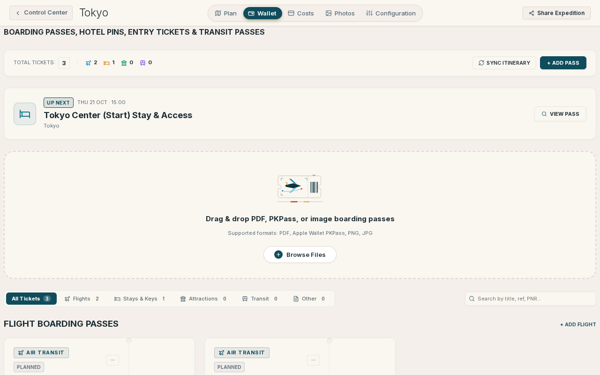

# Bookings Wallet, scanning, and scannable passes

Store boarding passes, hotel confirmations, door PINs, attraction tickets, and Apple Wallet `.pkpass` bundles inside the **Wallet** tab of `/trips/[id]`, scan barcodes locally with zero cloud OCR calls, and display high-contrast passes at airport gates.

## Importing tickets into `WalletDropzone`

Paladio extracts reservation metadata deterministically on your server using `zxing-cpp` for 1D/2D barcodes and `tesseract-ocr` + `poppler-utils` for PDFs and screenshots, keeping personal travel documents private.

1. Open the **Wallet** tab inside `/trips/[id]`.
2. Drag and drop `PDF`, `PNG`, `JPG`, `JPEG`, `WEBP`, `TXT`, or Apple Wallet `.pkpass` files into `WalletDropzone`, or click **+ ADD PASS** to enter details manually or paste raw email confirmation text.
3. Review every extracted field (flight carrier, route, departure/arrival timestamps, PNR, seat, terminal/gate, venue, and decoded barcode payload) inside `ScanReviewModal`.
4. Confirm the draft to save it to `trip_tickets` and attach original uploaded files to `trip_ticket_attachments` (persisted on disk under `WALLET_STORAGE_DIR`).

## Supported ticket categories and specialized cards

`TripWalletView` renders tailored cards per booking category, tracks the next scheduled travel event in `WalletUpNext`, and surfaces gate or transit advisories automatically.

| Category filter | Card component | Key fields and behaviors |
| :--- | :--- | :--- |
| **Flights** | `FlightBoardingPassCard` | Origin/destination IATA codes, flight number, terminal/gate, seat, PNR, and boarding barcode |
| **Stays & Keys** | `HotelAccessCard` | Check-in/out times, room/unit, plus Fernet-encrypted **door PINs and Wi-Fi passwords** masked behind `SecretField` with one-click copy |
| **Attractions** | `AttractionPassCard` | Timed-entry slot, venue address, reservation code, and entry QR/barcode |
| **Transit** | `TransitTicketCard` | Rail/bus/ferry operator, route/zone, validity window, and scannable fare pass |
| **Other** | `GenericTicketCard` | Insurance policies, rental cars, tours, or custom notes and attachments |

## Displaying fullscreen scannable codes and syncing anchors

At airport security, boarding gates, or museum turnstiles, you can filter passes instantly and pop out high-contrast barcodes without zooming a PDF.

- **Filter and search**: Click `All`, `Flights`, `Stays & Keys`, `Attractions`, `Transit`, or `Other` pills, or type a confirmation code, venue, or flight number into the search bar.
- **Fullscreen scannable barcode**: Click any ticket card to open `TicketDetailModal`, where `CodeRenderer` renders crisp `QR`, `Aztec`, `PDF417`, `Code128`, or `DataMatrix` codes alongside original PDF/image attachments.
- **Sync to itinerary**: Click **SYNC ITINERARY** (or **RE-SYNC ITINERARY**) to align your trip's flight windows, hotel check-in/out depot times, and timed attraction anchors with your verified wallet passes.

!!! warning "Protect your secrets when sharing `.trip` packages"
    Ticket access codes (`access_code`, Wi-Fi keys, door PINs) are encrypted at rest with Fernet (`WALLET_ENCRYPTION_KEY`) and masked in MCP tool outputs. When exporting a `.trip` archive from **Share Expedition**, choose **Shareable** (`community_shareable`) to strip all PNR codes, raw barcodes, holder names, and ticket attachments, or **Full Vault** (`full_vault`) only for personal encrypted backups.
