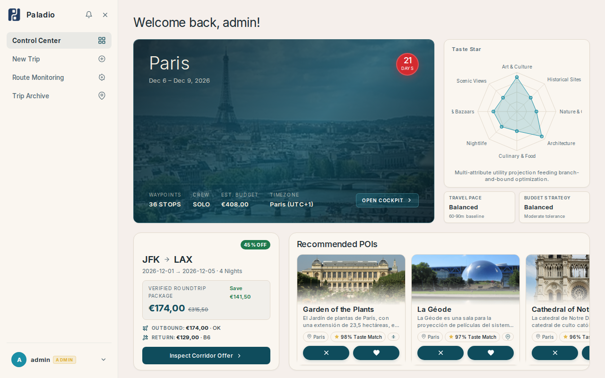

# Control Center and Taste Star

Navigate Paladio's application shell, interpret your 8-axis Taste Star radar, schedule expeditions on the operations Calendar with public holidays and Paid Time Off (PTO) markers, and manage saved Point of Interest (POI) collections from `/dashboard`.

## Application navigation shell and appearance

Paladio adapts its global navigation, theme palette, typography, and language direction dynamically per account so the workspace matches your preferred reading density and screen size.

- **Collapsible Sidebar or Floating Dock**: Switch between the left `AppSidebar` (toggle with `Ctrl+B` or `Cmd+B`) and the bottom hover-reveal `FloatingDock` inside **Settings** (`/config`). Both expose **Control Center** (`/dashboard`), **New Trip** (`/engine`), **Route Monitoring** (`/monitoring`), and **Trip Archive** (`/vault`), while the user menu links to **Settings** (`/config`), **Help Center** (`/help`), and **Sign Out**.
- **Pacific Jazz themes and typography**: Choose **Pacific Jazz Light**, **Pacific Jazz Dark**, or **Silent Waters**, and pair them with **Inter** (universal multi-script stack) or **Classic** (**Jost** display + **Inter** body + **JetBrains Mono**).
- **10 shipped locales with RTL support**: Switch between Arabic (`ar`, flips `<html dir="rtl">` automatically), Chinese Simplified (`zh-CN`), English (`en`), French (`fr`), German (`de`), Italian (`it`), Japanese (`ja`), Korean (`ko`), Portuguese (`pt`), and Spanish (`es`).
- **Global notifications**: Click the header bell icon to open the slide-out notification center (persisted up to 100 items per user in `localStorage`) for deal alerts, GTFS transit build completions, POI hydration jobs, and ticket scans.

## Control Center widgets

Every widget on `/dashboard` pulls live state from PostgreSQL, pgvector semantic matching, and Celery Beat market telemetry.

| Widget | Source data | Primary action |
| :--- | :--- | :--- |
| **Active Trip Ticket** | Next upcoming or active trip in PostgreSQL | Click the boarding-ticket hero card to launch `/trips/[id]` with countdown, waypoint count, participant roster, and local timezone |
| **Taste Star** | `UserTasteProfileModel` 8-axis preference vector | View scores across 8 travel categories alongside **Travel Pace** and **Budget Strategy** badges |
| **Best Offer Card** | Lowest verified 10th-percentile (`P10`) deal in `/monitoring` | Inspect destination savings and jump straight to Route Monitoring or pre-fill New Trip (`/engine`) |
| **Recommended POIs** | 768-dimensional ONNX vector cosine match in pgvector | Browse personalized attractions with verified Wikimedia photos, `% Taste Match`, and **Add to Trip** |
| **Upcoming Trips** | Active and draft expeditions | Open a workspace or delete an unused draft |
| **Saved Collections** | Global `TripCollectionModel` lists (`trip_id IS NULL`) | Organize reusable place wishlists or import stops into a trip |

## Seed and tune your 8-axis Taste Star

When an account starts with a neutral preference vector (`0.5` across all axes), Control Center displays a calibration banner linking to `/taste-calibration`.

1. Open `/taste-calibration` and answer up to 8 scenario prompts (`first_morning`, `afternoon_pace`, `urban_form`, `dining_style`, `after_sunset`, `markets_craft`, `budget_strategy`, and `crowd_discovery`), skipping any dimension you want to keep neutral.
2. Inspect your updated radar across `art_culture`, `history_heritage`, `nature_outdoors`, `architecture`, `food_culinary`, `nightlife`, `shopping`, and `scenic_views`.
3. As you bookmark POIs into collections, complete trips, or set likes and vetoes via the optional assistant, Paladio updates your `UserTasteProfileModel` and retrains ranker weights nightly via Celery Beat.
4. Export, reset to neutral, or delete your stored taste history anytime from **Settings** (`/config`) or the `/api/users/me/taste` endpoints.

!!! tip "Deterministic guardrails never sacrifice logistics for taste"
    High `% Taste Match` boosts a venue's priority during candidate selection, yet the C++20 solver enforces opening hours, meal spacing, walking fatigue limits, and district clustering so schedules stay realistic.

## Operations Calendar, public holidays, and PTO mode

The interactive Calendar on `/dashboard` overlays active trips, archived trips, monitored P10 flight deals, statutory public holidays for your configured country, and personal PTO days across both an annual dispatch grid and a focused monthly view.

1. Set your statutory holiday country under **Settings** (`/config` in **Personal Account**).
2. Enable **Holiday Mode** on the Calendar to click dates and toggle personal PTO days, or clear an entire year's PTO selections in one click.
3. Click any open calendar date to open `/engine?start_date=YYYY-MM-DD`, click any highlighted deal bar to jump directly to `/monitoring?route=<route_id>`, or export all trips and monitored deal windows into a single `.ics` calendar file.
