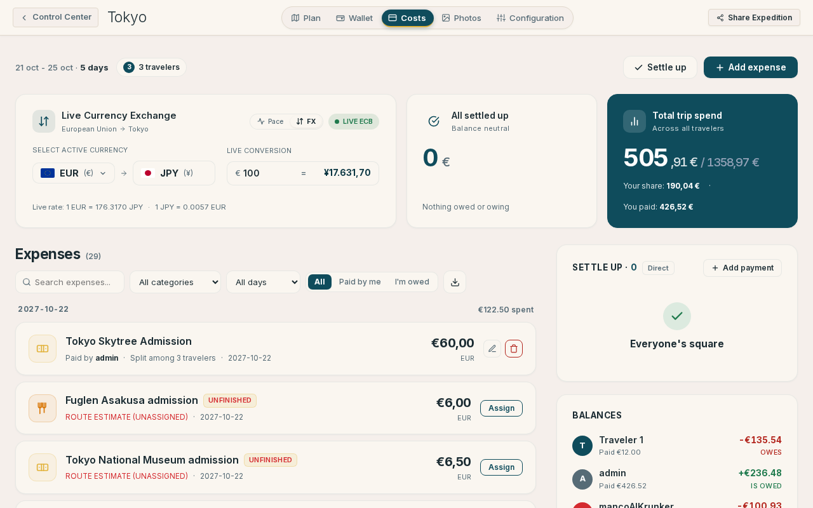

# Costs, live currency conversion, and group splitting

Compare actual expenses against your target budget in the **Costs** tab of `/trips/[id]`, convert currencies with live European Central Bank (ECB) rates, assign planned route estimates into real ledger entries, scan receipts, and settle group debts with minimal transfers.

## Reading cost summary cards and category breakdowns

`TripCostsView` separates projected route admissions from recorded expenses so you always see both committed spending and remaining headroom.

| Dashboard card | What it tracks |
| :--- | :--- |
| **Pending costs / All costs paid** | Itinerary stops with estimated entry prices that have not yet been assigned as paid expenses |
| **You owe / You're owed / All settled up** | Your net group balance across all Crew Roster splits in the trip ledger |
| **Total trip spend** | Recorded expenses vs target budget, paired with `CategoryBreakdownWidget` across `flights`, `accommodation`, `transport`, `food`, `activities`, `sightseeing`, and `other` |

Use the **Live Currency Exchange (LIVE ECB)** bar and 3D `CurrencyWheelPicker` to preview every figure across currencies in real time without altering stored receipt amounts.

## Assigning route estimates and scanning receipts

You do not need to re-type admission costs or transit estimates already present in your itinerary.

1. Scroll to any unassigned **Route Estimate** card in **Costs** and click **Assign** to convert that planned stop estimate into a recorded expense item (choose payer and participants).
2. Click **Add expense** (`ExpenseModal`) to log a new transaction manually, or upload a receipt image/PDF (`POST /api/trips/{trip_id}/expenses/scan-receipt`) to pre-fill merchant, total amount, currency, and date via Tesseract OCR.
3. Filter recorded entries by category, payer, or search query via `CostsFilterToolbar`, or click **Export CSV** to download the full ledger for external accounting.

## Splitting expenses and settling group balances

Paladio computes exact per-person shares across your trip's **Crew Roster** (`trip_participants`) and simplifies multi-party debts into the fewest possible bank transfers.

1. Open **Add expense** (or edit an existing entry), pick who paid, and choose **Equal** or **Custom** split amounts across selected Crew Roster members.
2. Inspect `BalancesWidget` to verify each traveler's net position (`GET /api/trips/{trip_id}/settlement`).
3. Click **Settle up** to open `SettlementModal`, which lists the minimal sequence of peer-to-peer transfers required to bring every participant's balance to zero.
