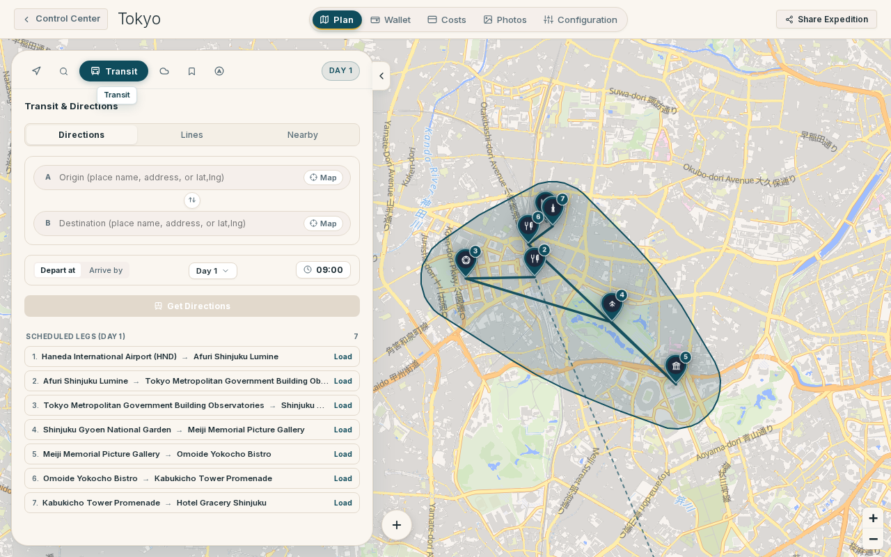

# Public transit and Valhalla routing

Inspect step-by-step metro, rail, tram, and bus routes, browse local transit lines, check real-time-style station departures, and compute street-level walking legs inside `Plan -> Transit` powered by self-hosted Valhalla, Transitous, and locally compiled GTFS schedules.

## How Paladio combines Valhalla, GTFS, and Transitous

Unlike cloud trip planners that hit external commercial API quotas, Paladio computes street-level walking and driving matrices locally while compiling official open transit schedules into PostgreSQL.

| Layer | Engine / Source | What it powers |
| :--- | :--- | :--- |
| **Walking and road routing** | Self-hosted `valhalla` container + OSM PBF extracts | Accurate footpath distances, door-to-door walking leg durations, and travel matrices for the C++20 solver |
| **Local transit schedules** | Compiled GTFS feeds derived into 14 PostgreSQL tables | Sub-second offline-capable queries for **Directions**, **Lines**, **Nearby** stations, stop timetables, and map overlays |
| **Live fallback routing** | Transitous (`api.transitous.org`) with Redis cache | Supplements transit leg routing when a destination lacks a compiled local GTFS feed |
| **Transit fare estimation** | 5-tier `FareResolver` (GTFS fares + ODPT Tokyo + TfL London + cited official quotes) | Accurate per-leg transit cost estimation and daily pass vs single-ticket advice |

## Three transit modes inside `Plan -> Transit`

Open the **Transit** tab in your workspace sidebar to switch between point-to-point routing, full network line exploration, and station departure boards.

| Tab mode | Inputs and filters | Output |
| :--- | :--- | :--- |
| **Directions** | Any two itinerary stops or custom coordinates, day selector, `Depart at` or `Arrive by` time | Multimodal itinerary combining exact walking transfers, line headsigns, stop counts, and leg durations |
| **Lines** | Independent `Metro`, `Rail`, `Tram`, and `Bus` mode chips | Agency-grouped network routes; clicking a line draws its full alignment and ordered station sequence on the map |
| **Nearby** | Active map viewport or Speed Dial **Area Filter** | Closest transit stations with walking distance and upcoming scheduled departures |

## Filter by transit mode and Speed Dial waypoint area

Use mode chips and spatial area filtering together to isolate transit options around a hotel or neighborhood before locking stops.

1. Click any combination of **Metro**, **Rail**, **Tram**, and **Bus** chips at the top of the **Transit** tab (all four toggle independently).
2. Expand the bottom-left **Speed Dial (`+`)** on the map and click **DROP WAYPOINT** to place a spatial radius circle over a district you want to explore.
3. Activate **Area Filter** in **Transit** so **Nearby** stations and lines snap strictly to that circle, then click any station pin or card to inspect serving lines and upcoming departures.

## Checking and compiling GTFS city coverage

At the top of `Plan -> Transit`, Paladio shows the GTFS build status for your destination city (`READY`, `BUILDING`, `QUEUED`, or `UNAVAILABLE`).

- **Automatic sync for planned trips**: Administrators can compile GTFS feeds for all upcoming cities at once from **Settings** (`/config` under **City Data**) using **Sync Planned Trips GTFS**.
- **Upgrading existing itineraries**: After a city's GTFS feed finishes compiling in the `transit_build` queue, trigger `POST /api/trips/{trip_id}/upgrade-transit` (or use the `upgrade_trip_transit` agent tool) to replace estimated transit legs with real compiled schedule connections.
- **Manual city compilation**: See [Managing city POIs, Valhalla maps, and GTFS](../self-hosting/city-data-and-gtfs.md) for queue locks, storage cleanup, and cities without public open GTFS feeds.
