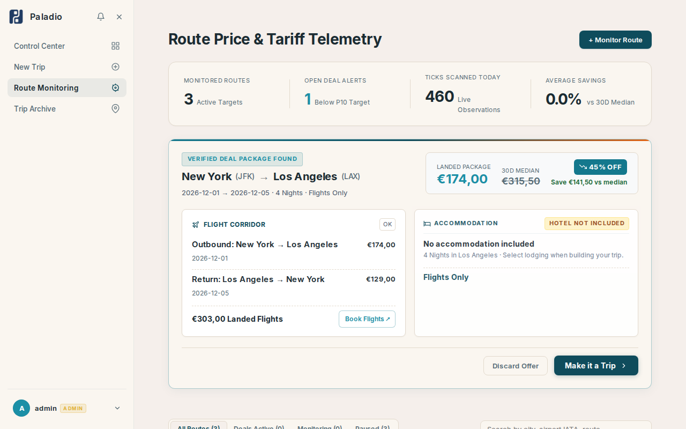

# Route monitoring and deal packages

Monitor round-trip flight and lodging corridors continuously at `/monitoring`, evaluate fare drops against 10th-percentile (`P10`) quantile baselines, inspect multi-month bidirectional calendars, and convert verified packages directly into trips in `/engine`.

## Fleet KPI cards and monitored routes table

Celery Beat triggers the daily market pipeline (`daily_market_pipeline_task`) at `03:00 UTC` (plus on-demand corridor sweeps and backfills), storing historical price ticks inside a TimescaleDB hypertable (`market_price_ticks`).

| Telemetry surface | What it reports |
| :--- | :--- |
| **Monitored Routes** | Count of active and paused origin-to-destination corridors tracked for your account |
| **Open Deal Alerts** | Active corridors whose verified fare sits below the 10th-percentile (`P10`) baseline threshold |
| **Ticks Scanned Today** | Total flight and lodging price observations collected in the current sweep window |
| **Average Savings** | Mean percentage discount across open deals compared against each corridor's 30-day median (`P50`) |

Filter the route table using **ALL**, **DEAL**, **ACTIVE**, or **PAUSED** pills, or search by origin/destination IATA code. Each route renders a `VerdictBadge` (`GREAT`, `GOOD`, `TYPICAL`, `HIGH`, `PEAK`) alongside its live percentile (`P<N>`) and baseline maturity (`building`, `provisional`, or `established`).

## Creating a monitored corridor

Define airport pairs, trip duration constraints, and per-passenger ceiling budgets so the Deal Engine ignores mismatched red-eyes or budget overruns.

1. Open `/monitoring` and click **+ Monitor Route**.
2. Choose **Origin** and **Destination** airports using live airport resolution.
3. Configure either a flexible date horizon or bounded departure dates, set minimum and maximum stay nights (1 to 30), traveler count, and your per-passenger budget ceiling with the currency picker.
4. Click **Save** (`POST /api/market/routes`) to trigger initial corpus backfill (`backfill_route_corpus_task`) and lodging prewarming (`prewarm_route_lodging_task`).

!!! note "Configuring Aviasales / Travelpayouts keys"
    Flight cache sweeps and live verifiers use your Travelpayouts/Aviasales token configured in **Settings** (`/config` under **API Keys & Secrets**) alongside Ryanair public fares and multi-provider hotel scrapers (`Booking`, `Google Travel`, `Agoda`, `Trip.com`).

## Acting on verified deal packages

When outbound and return flight fares align with a quality-gated hotel stay and the landed package drops below the `P10` target, `/monitoring` highlights a **VERIFIED DEAL PACKAGE FOUND** banner (and surfaces the best offer on Control Center).

- **Make it a Trip**: Pre-fills `/engine` via query parameters with exact outbound/inbound flight dates, airport times, verified lodging anchor, and package budget so you can generate a matching daily itinerary in one pass.
- **Discard Offer**: Dismisses that candidate alert (`POST /api/market/deals/{deal_id}/discard`) and records implicit negative deal feedback (`POST /api/market/deals/{deal_id}/feedback`) to refine future package verdicts.

## Full-screen route inspection and bidirectional calendars

Click **Inspect** on any corridor to launch `RouteFullScreenView`, pairing historical curve telemetry with date-by-date round-trip exploration.

1. Toggle **24h**, **7d**, **30d**, or **90d** on `PriceTrendGraph` to compare recent sweeps against historical quantile bands (`q02` through `q90`).
2. Switch **MonitoringCalendar** between **Outbound**, **Inbound**, and **Roundtrip** modes across multiple months to spot cheap departure/return pairs visually.
3. Click any calendar date to fetch live lodging rate observations (`GET /api/market/routes/{route_id}/lodging`) and compare combined flight + stay totals before booking.
4. Pause, resume, manually scan (`POST /api/market/routes/{route_id}/scan`), backfill (`POST /api/market/routes/{route_id}/backfill`), or delete the route from the inspection header.
