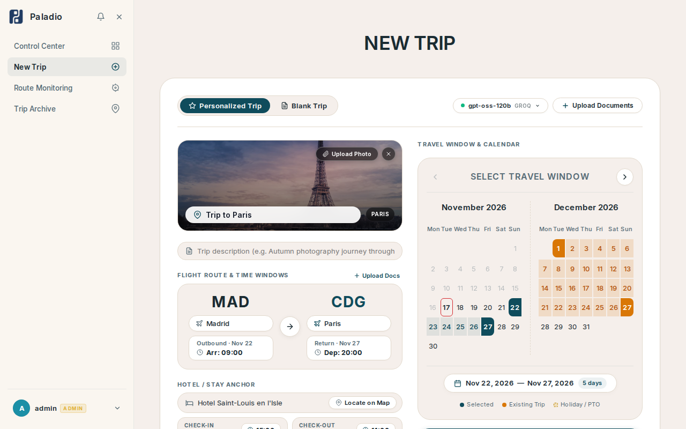

# Creating trips and intake workflows

Launch a Personalized Trip powered by the deterministic 9-node LangGraph swarm and C++20 optimizer, start from a Blank Trip canvas, or bootstrap an itinerary from flight confirmations, `.pkpass` tickets, and `.trip` archives at `/engine`.

## Personalized Trip versus Blank Trip

`/engine` offers two creation modes, persisting your unsaved form state automatically in `localStorage` (`useTripDraftStore`) so navigating away never loses your route draft.

- **Personalized Trip**: Executes the deterministic swarm over `WS /api/ws/stream`, streaming live `ThinkingScreen` stages (`PARSING_TICKETS`, `EXTRACTING_CONSTRAINTS`, `VERIFYING_CONSTRAINTS`, `EVALUATING_GUARDRAILS`, `ANALYZING_PROMPT`, `SCRAPING_DYNAMIC_DATA`, `EVALUATING_ROUTES`) before opening `/trips/[id]`.
- **Blank Trip**: Creates an empty expedition shell immediately for manual curation in the Trip Workspace without waiting for route optimization.

## Structured trip intake fields

Every intake card on `/engine` maps directly to constraints consumed by the 8-stage Itinerary v2 pipeline and C++20 TCOPTW solver.

| Intake control | What it configures | How the engine uses it |
| :--- | :--- | :--- |
| **Cover Banner** | Custom expedition header image or reset | Stored as the trip cover across Control Center, Workspace, and Archive recaps |
| **Flight Route Bar** | `ORIG` / `DEST` airport IATA codes plus arrival and departure hours | Constrains Day 1 start time after landing and final-day end time before airport departure |
| **Hotel Stay Anchor** | Hotel search or map pin selection with check-in and check-out times | Sets the daily start and return depot coordinate (`NodeType.HOTEL`) for `optimize_itinerary` |
| **Budget & Currency Wheel** | Target budget amount and 3D currency picker | Allocates pro-rata daily spending caps with live FX conversion against POI admission prices |
| **Crew Roster** | Linked Paladio user accounts and guest companions | Merges participant taste profiles during selection and initializes group expense splitting |
| **Travel Window** | Calendar date range picker | Sets trip duration (`<= 30` days guardrail) and seasonal weather / holiday context |
| **Intent Prompt** | Natural-language preferences and preset chips | Processed deterministically by `PromptIntentExtractor` using 768-D ONNX anchor projection and `rapidfuzz` POI matching |

!!! note "Where Exploration Pace lives"
    You adjust a specific trip's daily tempo (`Relaxed`, `Balanced`, or `Packed / High Tempo`) inside that trip's **Configuration** tab after creation. Global default walking caps, meal deadlines, and fatigue multipliers live in **Settings** (`/config` under **Solver Constraints & Pacing**).

## Uploading bookings, `.pkpass`, and `.trip` packages

Instead of typing flights and stays manually, click the upload icon (`+`) on `/engine` to import travel documents or previously exported expeditions.

1. Drop `PDF`, `PNG`, `JPG`, `JPEG`, `WEBP`, `TXT`, or `JSON` booking files, Apple Wallet `.pkpass` bundles, or `.trip` archives into the modal, or paste raw confirmation email text directly.
2. Wait for the deterministic local scanner (`zxing-cpp` for IATA BCBP barcodes, `tesseract-ocr` + `poppler-utils` for PDFs and images, and regex extractors for text) to populate origin, destination, dates, and hotel anchors.
3. For `.trip` packages (`application/vnd.paladio.trip+zip`), Paladio restores the itinerary, collections, photos, and (for `full_vault` exports) wallet passes and expenses directly into a new trip workspace.

## Safety and human-in-the-loop checkpoints

During Personalized Trip generation, the LangGraph swarm can pause or halt via structured interactive modals when validation checks detect conflicts.

- **Verification Required** (`verify_constraints` interrupt): Presents extracted dates, airports, budget, and hotel anchor for confirmation or last-second edits before scraping and C++ solving start.
- **Trip Overlap Warning** (`guardrails` interrupt): Alerts you when your requested dates collide with an existing trip stored in PostgreSQL so you can cancel or proceed intentionally.
- **Guardrail Abort**: Rejects invalid spans immediately (dates in the past, return date earlier than start date, identical origin and destination, or trips exceeding 30 days).

## Launching trips from Calendar and Route Monitoring

You can pre-fill `/engine` with one click from other views using URL query parameters handled by `dealToTrip.ts`:

- **From Control Center Calendar**: Clicking a calendar date opens `/engine?start_date=YYYY-MM-DD`.
- **From Route Monitoring**: Clicking **Make it a Trip** on a `VERIFIED DEAL PACKAGE FOUND` banner or **Best Offer Card** preloads the deal's origin, destination, outbound/inbound flight dates, hotel anchor, and package budget into `/engine`.
