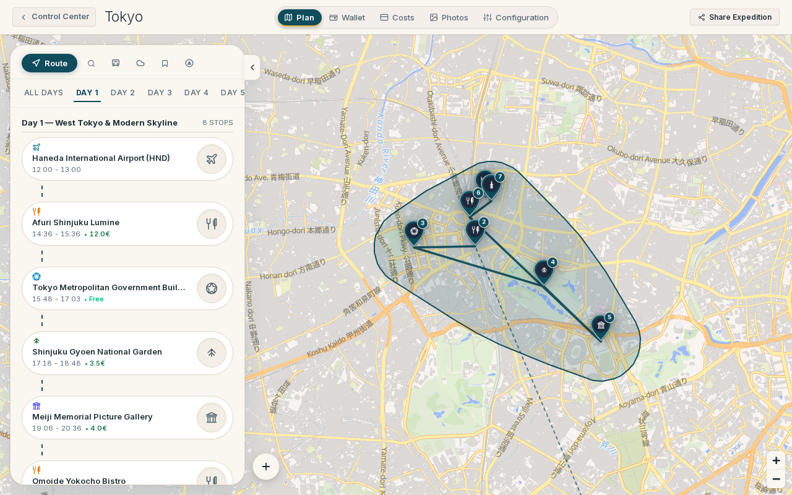

# Trip Workspace, map controls, and editing

Manage your active itinerary inside `/trips/[id]` using the Leaflet + MapLibre GL 2D map, 6-tab **Plan** sidebar, bottom-left Speed Dial (`EDIT ROUTE`, `DROP WAYPOINT`, `VIEW`), custom POI creator, external navigation launchers, and IndexedDB offline pinning.

## Workspace header and top-level tabs

Every trip workspace opens to a full-screen layout with a compact top bar linking the five operational views of your expedition.

| Header control | Purpose |
| :--- | :--- |
| **Plan** | Pairs the 6-tab left planning sidebar (`Route`, `Search`, `Transit`, `Weather`, `Collections`, `Agent`) with the interactive route map |
| **Wallet** | Stores boarding passes, hotel keys, attraction tickets, `.pkpass` bundles, and fullscreen scannable barcodes |
| **Costs** | Compares recorded expenses against your target budget, converts live ECB rates, and calculates group debt settlements |
| **Photos** | Displays local uploads and albums synchronized from Immich or Synology Photos |
| **Configuration** | Edits flight windows, hotel anchor, **Exploration Pace**, budget, Crew Roster, trip status, and activity revision history |
| **Offline Pin button** | Downloads trip JSON, Wallet passes, ticket attachments, and expenses into browser IndexedDB for offline access |
| **Share Expedition** | Opens exports for `.trip` packages, Printable PDF Dossier, `.ics`, `.gpx`, and `.json` |

!!! note "Completed trips redirect to `/vault/[id]`"
    Once you mark an expedition **Completed (Archived in Vault)** inside **Configuration**, navigating to `/trips/[id]` automatically redirects to its read-only recap at `/vault/[id]`. Append `?workspace=1` to reopen the full live editor anytime.

## Navigating the six sidebar tabs inside Plan

All daily scheduling, discovery, weather checks, and agent edits share the left panel inside **Plan**, syncing selection state with the map markers on the right.

1. **Route**: Displays `ALL DAYS`, day tabs (`DAY 1`, `DAY 2`, …), `+ Day` to extend your trip, hotel anchors, numbered stop cards, and clickable transit leg connectors showing walk or GTFS transit steps.
2. **Search**: Queries destination POIs with category chips, rating/duration/price filters, sort controls, a **Custom** filter toggle, bookmark buttons, and **Add POI** to drop a custom pin anywhere on the map.
3. **Transit**: Provides **Directions**, **Lines**, and **Nearby** views powered by Valhalla and compiled GTFS feeds. See [Public transit and Valhalla routing](public-transit-and-routing.md).
4. **Weather**: Fetches Open-Meteo daily forecasts, Air Quality Index (AQI) alerts, and travel advisories, or seasonal historical climate averages when your departure date lies beyond forecast range.
5. **Collections**: Lets you browse saved or trip-scoped bookmark collections, track `visit_status`, import GPX/KML/KMZ or Google Maps lists, and insert saved places directly into any trip day.
6. **Agent**: Opens the optional interactive AI Travel Assistant (`TripAgentRunner`) with viewport context injection and human-in-the-loop proposal cards.

## Editing routes with the bottom-left Speed Dial

Click the circular **`+`** Speed Dial button at the bottom-left corner of the map to unlock direct timeline editing, spatial filtering, and card density toggles.

| Speed Dial toggle | States | Behavior |
| :--- | :--- | :--- |
| **Edit mode** | `EDIT ROUTE` / `EDITING ACTIVE` | Reveals drag handles, lock buttons, delete buttons, and the **Solve** button on every day card |
| **Spatial radius** | `DROP WAYPOINT` / `CLEAR AREA` | Places a draggable circle on the map with adjustable radius; filters both the **Search** and **Transit** tabs to that zone |
| **Card detail** | `VIEW: SIMPLE` / `VIEW: DETAILED` | Switches between compact stop titles and expanded schedules with full transit connectors |

Follow these steps to reshape a day without losing booked time slots:

1. Expand the bottom-left Speed Dial (`+`) and activate **EDIT ROUTE**.
2. Click the lock icon on fixed-time stops (such as timed museum tickets or restaurant bookings) so the optimizer treats them as immutable anchors.
3. Drag stops to reorder them manually or remove unwanted stops.
4. Click **Solve** to invoke the C++20 `solve_tsptw` (with `solve_tsp_tour` fallback) re-optimizer, which recalculates optimal stop ordering and walking or GTFS transit legs while honoring your locked stops.

## Inspecting POIs and launching external navigation

Clicking any card or map pin opens `PoiDetailView` with Wikimedia photos, opening hours, admission pricing provenance, description translation (via DeepL or LibreTranslate when configured), and direct navigation handoffs.

- **External navigation apps**: Launch any stop's exact coordinates in **Google Maps**, **Apple Maps**, **CoMaps / Organic Maps**, **OsmAnd**, **Waze**, or **Citymapper**, or download a single-POI `.gpx` waypoint file.
- **Creating custom stops**: Open **Plan -> Search**, click **Add POI**, pick exact coordinates on the location picker map, set duration and category, and save the custom pin exclusively to that trip without altering the shared global POI catalog.

## Offline PWA pinning and revision recovery

Paladio registers a Service Worker (`sw.js`) for static shell and map tile caching (`OpenFreeMap`, `OpenStreetMap`, `Carto`) and pairs it with IndexedDB (`offlineStore.ts`) for field reliability when cellular data drops.

- **Pin a trip offline**: Click the offline pin icon in the workspace header before boarding; Paladio caches the full itinerary JSON, Wallet tickets, attached ticket files, and recorded expenses locally.
- **Revert or restore revisions**: Every manual edit, drag reorder, re-optimization, and agent mutation creates an immutable snapshot in `trip_revisions`. Trigger **Revert** or **Restore** via the API or agent `Undo` to roll back safely.
