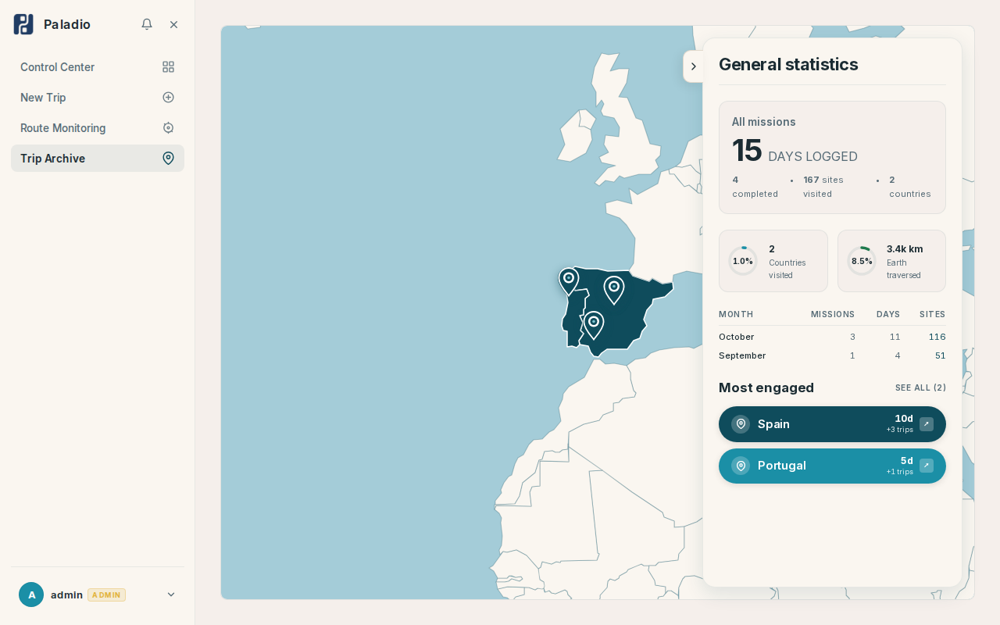

# Trip Archive, Vault recaps, photos, and sharing

Explore all completed expeditions on the interactive world map at `/vault`, review read-only recaps at `/vault/[id]`, manage trip galleries with Immich or Synology Photo sync, and export trips in `.trip`, PDF, `.ics`, `.gpx`, or `.json` formats.

## World `VaultMap` and lifetime travel telemetry

When you mark a trip **Completed (Archived in Vault)** inside **Configuration**, it moves onto the global `/vault` map alongside cumulative travel statistics.

| Vault telemetry metric | Calculation |
| :--- | :--- |
| **All missions & Days logged** | Total archived expeditions and cumulative travel days across all completed trips |
| **Countries visited & Most engaged** | Highlighted world GeoJSON country polygons plus top visited destinations ranked by trip count and days |
| **Earth distance gauge** | Cumulative flight and route distance compared against Earth's equatorial circumference (`40,075 km`) |
| **Monthly breakdown** | Chronological timeline table grouping completed trips by month and destination |

Click any destination in the collapsible **General statistics** drawer to fly the `VaultMap` camera directly to that country, or click a trip pin to open its recap at `/vault/[id]`.

## Completed trip recaps (`/vault/[id]`)

`/vault/[id]` renders `PastTripRecap` as a read-only chronicle with flight strips, route maps, and four focused tabs (`About`, `Itinerary`, `Costs`, `Photos`).

1. Open **About** to read or edit your retrospective expedition narrative and private field notes.
2. Browse **Itinerary**, **Costs**, and **Photos** for an archive view without accidental route edits.
3. Append `?workspace=1` (or `?force=1`) to `/trips/[id]` whenever you want to reopen the full editing workspace on a completed trip.

## Managing trip photos and NAS / Immich sync

The **Photos** tab inside both active workspaces (`/trips/[id]`) and Vault recaps (`/vault/[id]`) lets you upload local high-resolution images and synchronize albums from self-hosted photo servers.

- **Local uploads**: Drag and drop images via `PhotoUploadModal` (`POST /api/trips/{trip_id}/photos`); Paladio serves them directly from disk (`PHOTO_STORAGE_DIR`).
- **Immich and Synology Photos sync**: Configure server credentials in **Settings** (`/config` under **Data Vault & Backups -> Photo Sync**) so Paladio automatically matches trip dates to remote albums and pulls vault memories.

## Exporting and sharing via Share Expedition

Click **Share Expedition** from any trip header (`/trips/[id]` or `/vault/[id]`) to copy the workspace link or export portable files in five formats.

| Export format | What it includes | Filtering and privacy options |
| :--- | :--- | :--- |
| **Paladio Package (`.trip`)** | Self-contained ZIP archive (`application/vnd.paladio.trip+zip`) with SHA-256 manifest, itinerary, collections, and photos | Choose **Full Vault** (keeps private Wallet passes, receipts, and expenses) or **Shareable** (`community_shareable`, strips PNR/barcodes/attachments/expenses and anonymizes travelers) |
| **Printable Document (`.pdf`)** | Clean `TripPrintDossier` layout printed via browser print-to-PDF | Formats daily schedules, addresses, and leg timings for offline paper backup |
| **Calendar Sync (`.ics`)** | RFC 5545 calendar events for timed stops and bookings | Filter by **All Days** or select specific trip days |
| **GPX Track (`.gpx`)** | Waypoints and route tracks for Garmin, OsmAnd, CoMaps, and GPS apps | Filter by **All Days** or select specific trip days |
| **Raw Itinerary (`.json`)** | Complete structured itinerary payload | Filter by **All Days** or select specific trip days |

See [`.trip` file format specification](../reference/trip-file-format.md) for exact archive layout and sanitization details.
